「診断情報を保存」は、SQExcelで不具合が発生したときに、その原因調査に必要な**環境情報**と**ログ**を1つのZIPファイル（診断情報ZIP）にまとめて保存する機能です。ホーム画面・IO操作画面のどちらのメニュー「ツール → 診断情報を保存...」からも開けます。

不具合の報告は、SQExcelの GitHub Issues を通じて行います。保存した診断情報ZIPを、ご自身でIssueに添付してください。

:::note[SQExcelが診断情報を自動で送信することはありません]
診断情報の保存はSQExcelの中だけで完結します。外部への送信は行いません。Issueへの添付は、内容をご確認のうえ、利用者ご自身の操作で行います。
:::

:::caution[GitHub Issues は公開されています]
Issueに添付したファイルは、第三者も閲覧できます。ログに含まれる機密情報（サーバー名、パス、データの値など）が残っていないことを、保存前に必ずご自身の目で確認してください。
:::

## 診断情報ZIPに含まれるもの

| ファイル | 内容 |
|---|---|
| `environment.json` | SQExcelの版数、OSの種類、.NETの版数、表示言語、開いているプロジェクトのデータベースの種類、オプション設定（ログレベル・ログ保存日数・パスワード保存方式）、各DBドライバの版数 |
| `logs/*.log` | 対象期間内のログのうち、「含める」にチェックがあるエントリ。マスクを適用済み。ログファイルの日付ごとに分けて格納されます |
| `README.txt` | 作成日時、ZIPの内容の説明、適用したマスクの種類、ログの対象期間、除外したログ行の数、注意書き（表示言語のみで記載） |

**含まれないもの**：DB接続のパスワード・暗号化キー、接続文字列、`.qtxl` ファイル、入力シート（Excelファイル）、取り込みに使用したSQL。環境情報にもサーバー名・ユーザー名・ファイルのパスは含めません。

## 診断情報を保存ダイアログの画面構成

メニュー「ツール → 診断情報を保存...」を選択すると、次の画面が開きます。ダイアログを開くと、ログフォルダ内のログがエントリ（1件分のログ）ごとに読み込まれ、**マスク前の元の内容**で表示されます。

   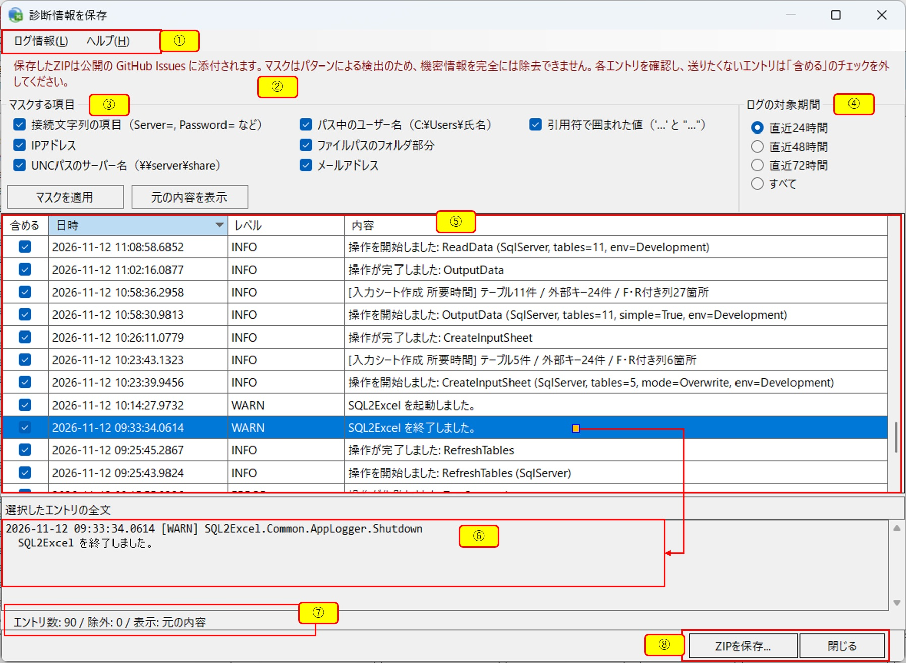

| No. | 領域 | 内容 |
|---|---|---|
| ① | トップメニュー | ログイン情報(L)：選択した行を含める／選択した行を含めるの解除（＝ログ一覧で選択された行の操作）   ヘルプ(H)：操作方法（＝オンラインヘルプの該当ページの表示） |
| ② | 警告文 | 保存したZIPは公開のGitHub Issuesに添付されること、マスクは機密情報を完全には除去できないことを示す注意書き |
| ③ | マスクする項目 | マスクの種類を7つのチェックボックスで選択（既定はすべてON）。［マスクを適用］［元の内容を表示］ボタン |
| ④ | ログの対象期間 | 直近24時間（既定）／直近48時間／直近72時間／すべて |
| ⑤ | ログ一覧 | 1行が1エントリ。列は「含める」「日時」「レベル」「内容」 |
| ⑥ | 選択したエントリの全文 | ④で選択中のエントリの全文（複数行のメッセージ、エラー時のスタックトレースを含む） |
| ⑦ | ステータス | 「エントリ数: N / 除外: M / 表示: 元の内容（またはマスク済み）」 |
| ⑧ | ボタン | ［ZIPを保存...］［閉じる］ |

「エントリ」とは１つのログで出力された文章全体を指します。
ログが1件も見つからない場合は、「ログが見つかりませんでした。環境情報のみが含まれます。」と表示されます。この場合も、環境情報のみのZIPを保存できます。

## 操作の流れ

診断情報ZIPは、次の手順で保存します。

1. メニュー「ツール → 診断情報を保存...」を選択して、ダイアログを開きます。
2. [ログの対象期間](#ログの対象期間を選ぶ)を選びます。
3. [マスクする項目](#機密情報をマスクする)を選んで［マスクを適用］をクリックし、表示をマスク後の内容に切り替えます。
4. ログ一覧と全文を確認し、送りたくないエントリは[「含める」のチェックを外します](#送るエントリを取捨選択する)。
5. ［ZIPを保存...］をクリックし、[確認ダイアログと保存先の指定](#zipを保存する)に進みます。
6. 保存したZIPを、GitHub Issuesに添付して報告します。

### ログの対象期間を選ぶ

「ログの対象期間」のラジオボタンで、診断情報に含めるログの範囲を選びます。

- 既定は**直近24時間**です。不具合が発生した直後に保存する場合は、既定のままで十分です。
- 発生から日数が経っている場合や、再現手順に複数日の操作が関わる場合は、直近48時間・72時間・すべてを選びます。
- 期間外のエントリは、ログ一覧に表示されず、ZIPにも入りません。
- 期間を切り替えても、すでに外した「含める」のチェックは保持されます（期間を戻しても、チェックは外れたままです）。
- 日時を判別できないエントリは、期間にかかわらず表示されます。
 
---
「直近24時間」を選択した場合

   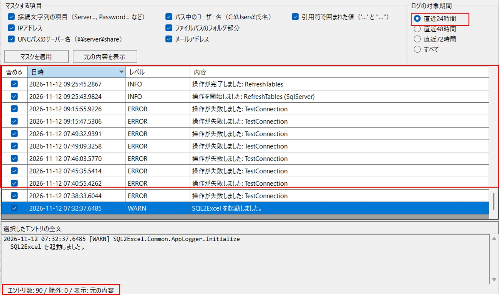

「すべて」を選択した場合

   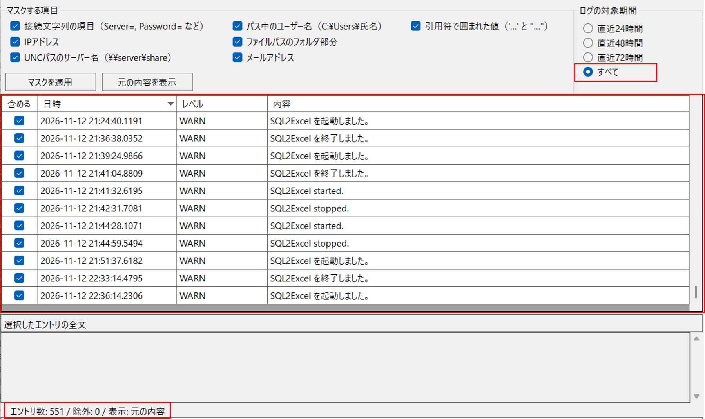

### 機密情報をマスクする

ログには、エラーの原因調査に役立つ情報とあわせて、サーバー名やファイルのパスなどの機密情報が含まれることがあります。これらをパターン（文字の並び）によって検出し、伏せ字に置き換えるのが**マスク**です。

「マスクする項目」で置き換えたい種類にチェックを入れ、［マスクを適用］をクリックすると、ログ一覧と全文の表示がマスク後の内容に切り替わります。［元の内容を表示］で元の表示に戻せます。

| マスクの種類 | 対象 | 置き換え後の例 |
|---|---|---|
| 接続文字列の項目 | `Server=`、`Password=`、`User Id=`、`Database=`、`Port=` などの値 | `Password=***` |
| IPアドレス | IPv4アドレス（ポート番号付きを含む） | `***` |
| UNCパスのサーバー名 | `\\server\share` のサーバー名部分 | `\\***\share` |
| パス中のユーザー名 | `C:\Users\氏名` のユーザー名部分 | `%USERPROFILE%` |
| ファイルパスのフォルダ部分 | ドライブ付きパスのフォルダ。ファイル名だけを残す | `<DIR>\ファイル名` |
| メールアドレス | メールアドレス | `***` |
| 引用符で囲まれた値 | `'…'` や `"…"` で囲まれた値。データの値やオブジェクト名が混入しやすい | `'***'` |

「元の内容を表示」をクリックした場合（サーバー名やユーザー名が読める状態）

   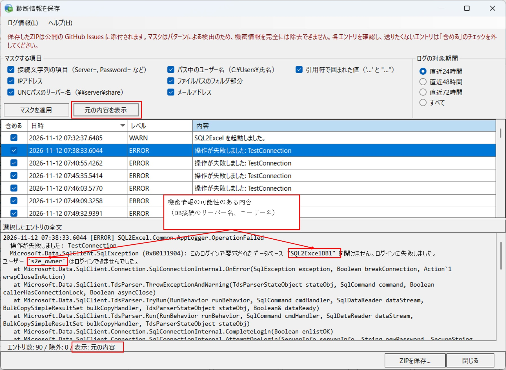

「マスクを適用」をクリックした場合（サーバー名やユーザー名がマスクされる）

   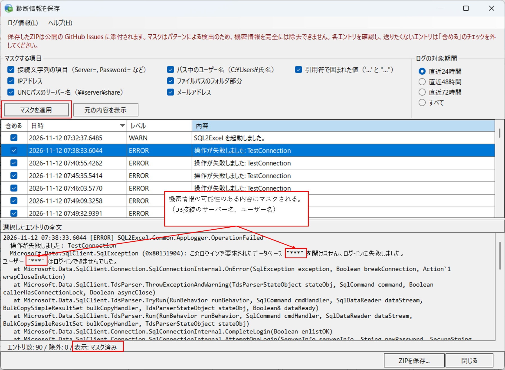

:::caution[マスクは完全ではありません]
マスクはパターンによる検出であり、機密情報をすべて取り除けるとは限りません。特に、エラーメッセージの中に混ざったデータの値は検出しきれないことがあります。マスクを適用したあとも、ログ一覧と全文を目で確認してください。
:::

### 送るエントリを取捨選択する

ログ一覧の「含める」のチェックを外したエントリは、ZIPに入りません。マスクをしても残ってしまう情報や、報告に関係のないエントリは、ここで外してください。

- 「含める」のチェックを外すには一覧内で複数の行を選択した状態でコンテキストメニューより「選択した行の含めるを解除する」を実行するとまとめてチェックを外すことが出来ます。（トップメニューの「ログ情報 → 選択した行の含めるを解除する」からも実行できます。

   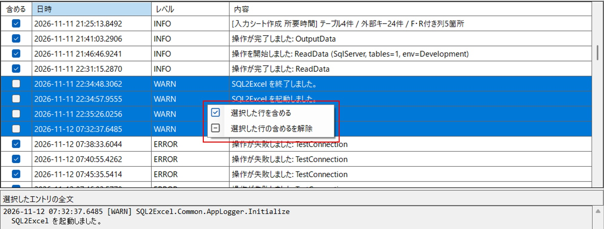

- 一覧の行をクリックすると、「選択したエントリの全文」にそのエントリの全文が表示されます。
- 一覧の「内容」には、エントリの先頭の1行が表示されます。2行目以降（スタックトレースなど）は全文欄で確認します。
- ステータスの「除外」に、チェックを外したエントリの数が表示されます。

   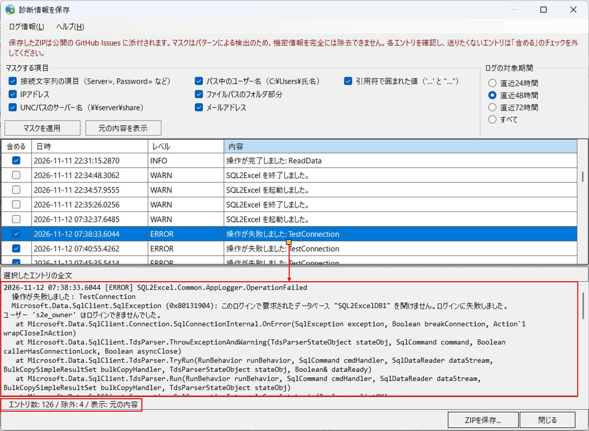

### ZIPを保存する

［ZIPを保存...］をクリックすると、次の順に処理されます。

1. **現在チェックされているマスクの種類が必ず適用**され、表示もその状態にそろいます。［マスクを適用］を押し忘れても、マスクなしで保存されることはありません。
2. 「表示中のマスク後の内容でZIPを保存します。機密情報が残っていないことを確認してください。」という確認ダイアログが表示されます。内容に問題がなければ［はい］をクリックします。
3. 保存先を指定するダイアログが開きます。ファイル名の既定は `SQExcel_Diagnostics_年月日_時分秒.zip` です。
4. ZIPが作成され、完了メッセージが表示されたあと、エクスプローラーで保存したファイルが選択された状態で表示されます。

**ZIPに保存される内容は、画面に表示されている（マスク後の）内容と一致します。**

- 診断情報を保存ボタンクリック時に表示される確認ダイアログ

   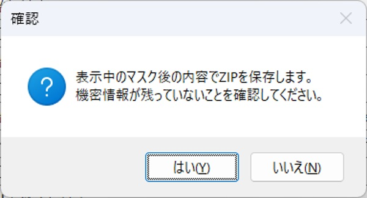

- 診断情報を保存先ファイル指定ダイアログ

   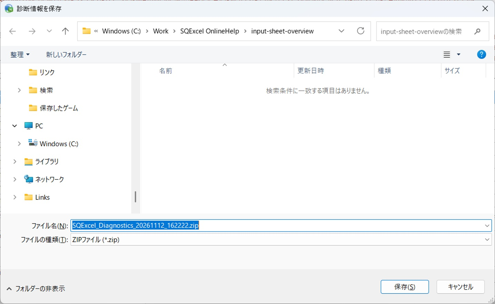

- 出力されたZIPファイルの中身

   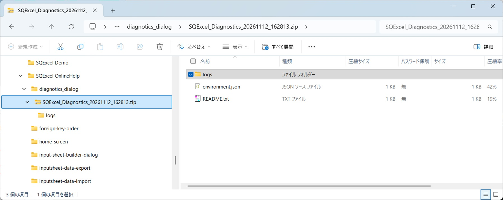

- ログファイルの内容

   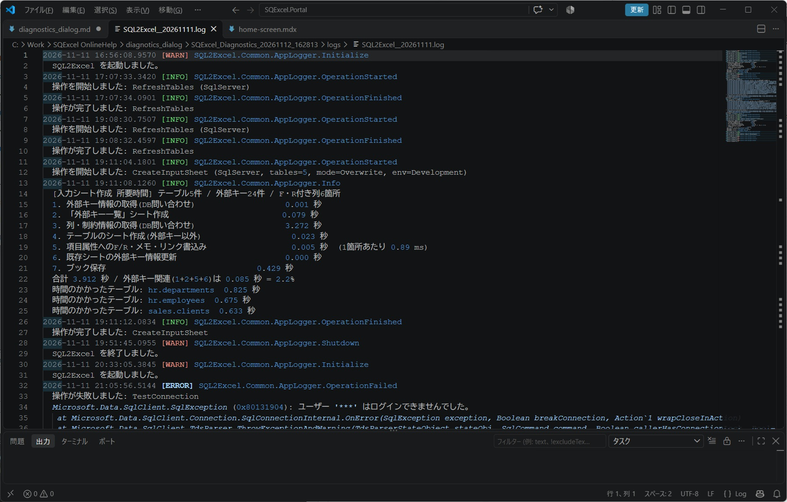

## GitHub Issuesで報告する

1. SQExcelのGitHubリポジトリの Issues ページを開き、新しいIssueを作成します。
2. 不具合の内容（どの画面でどの操作をしたか、表示されたメッセージ、期待した動作）を記入します。
3. 保存した診断情報ZIPをIssueに添付します。
4. 添付する前に、ZIPを展開して `logs` の中身をもう一度確認しておくと安心です。

## ログについて

診断情報ZIPに含まれるログは、SQExcelが自動的に記録しているものです。

| 項目 | 内容 |
|---|---|
| 保存場所 | `%APPDATA%\SQL2Excel\Logs\SQL2Excel__年月日.log`（日付ごとに1ファイル） |
| ログレベル | 「警告」（既定）はエラー・例外のみを記録します。「情報」は、それに加えて主な操作（入力シート作成、データ取り込み、データ出力、テーブル情報の再取得）の開始と終了を記録します |
| 保存日数 | 既定は14日（1〜90日で変更可）。この日数を過ぎたログは自動的に削除されます |

ログレベルと保存日数は、ホーム画面の「ツール → オプション」の「ログ」欄で変更できます（詳しくは[オプション設定の「ログの設定」セクション](/ja/docs/features/option-settings-dialog/#ログの設定)を参照）。

ログには、操作の種類とデータベースの種類・テーブル数などの補足情報のみを記録し、テーブル名やサーバー名などは記録しません。ただし、エラーメッセージの中にこれらが含まれることはあります。

:::tip[不具合を再現できるときは]
ログレベルを「情報」に変更してから不具合を再現し、直後に診断情報を保存すると、不具合に至るまでの操作の流れもログに残るため、原因の調査がしやすくなります。
:::

## 注意事項

- マスクは機密情報を完全には取り除けません。保存前に必ず内容を確認してください。
- ログに記録されるのは、エラーが表示される箇所と、入力シート作成・データ取り込み・データ出力などの処理の入口です。画面操作（クリックやドラッグ＆ドロップなど）はログに残らないため、ログに現れない不具合は、Issueの本文で操作手順を詳しくご記入ください。
- 診断情報の保存はSQExcelの中で完結し、外部への送信は行いません。
