## ワークブックとワークシートの対応

SQExcelの入力シートには、1つのワークブックの中に1つのテーブルグループの選択済みテーブルリストに含まれるDBテーブルのデータ入力用ワークシートがまとめて作成されます。 
SQExcelの「入力シート」はこのワークブックを指し、個々のテーブルデータ入力用ワークシートは「テーブルシート」、または「○○○○テーブルのワークシート」のように呼びます。
- テーブルシートは所定の構造を持つ必要があります。この条件については後続の「テーブルシートの構成」で説明します。
- 入力シート内にはテーブルシート以外に任意のワークシートを含めることが可能です。
- 入力シートの作成・更新では、ブックの最後尾に「外部キー一覧」シートが1枚作成されます。

## テーブルシートの構成

### テーブル情報ヘッダ部（1〜2行目）

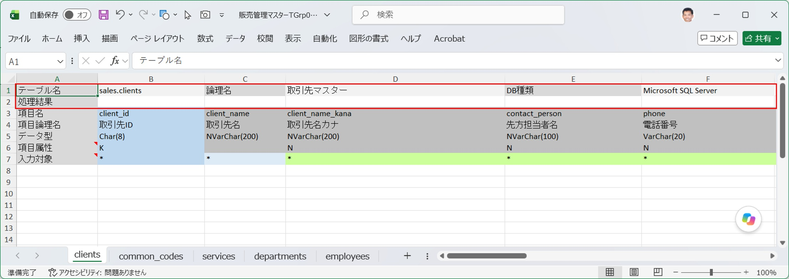

| セル | 内容 |
|---|---|
| A1 / C1 / E1 | 見出しラベル「テーブル名」「論理名」「DB種類名」 |
| B1 | `スキーマ名.テーブル物理名` 形式のテーブル名 |
| D1 | テーブル論理名（DB側に論理名が登録されていない場合は論理名を含めてブロック単位で非表示） |
| F1 | DB種類名（Microsoft SQL Server/ Oracle Database/ PostgreSQL/ MySQL/ MariaDB/ SQLite のいずれか） |
| A2 | 見出しラベル「処理結果」 |
| B2 | データ取り込み・データ出力の処理結果メッセージがここに書き込まれる |

### 項目ヘッダ部（3〜7行目）

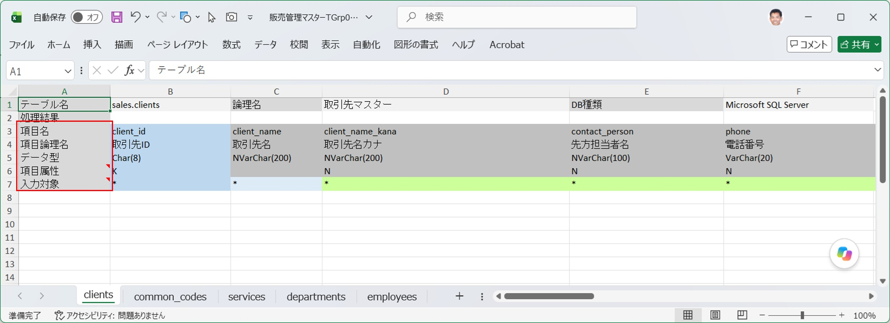

| 行 | 内容 |
|---|---|
| 3行目 | 項目物理名 |
| 4行目 | 項目論理名（取得できない場合は行自体が省略され、以降の行が1行ずつ繰り上がる） |
| 5行目 | データ型。DB種類に応じて定義されたデータ型を桁数や精度を含めて表示する。 |
| 6行目 | 項目属性。その列のテーブル項目が有する属性の種類を次の文字の組み合わせで表示する（K＝キー項目、A＝自動設定項目、N＝NULL許容項目、D＝既定値あり、F＝外部キー参照元、R＝外部キー参照先）。並びは K, A, N, D, F, R の順（例：KR、NF）。 複数の外部キーの参照元であればFのメモにすべてを列挙し、参照先が多数のRは先頭1件と「その他N件」で表示する |
| 7行目 | 入力対象マーク欄（`*` を入れた項目のみデータ取り込みの対象になり、実行されるSQLの処理対象項目となる。ただし処理種別=DELETEの場合は無視される。） |

項目ヘッダ部の項目属性と入力対象マーク欄をアクティブにすると項目の説明がメモとして表示されます。

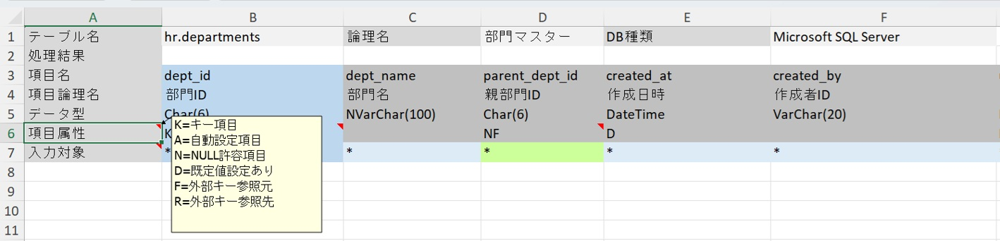

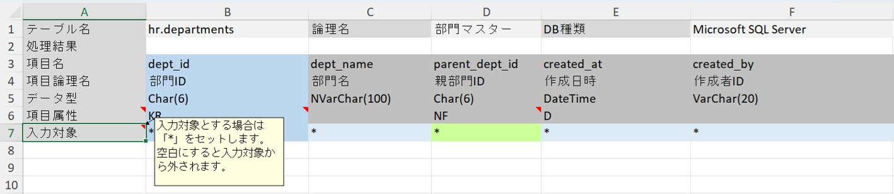

項目属性にFまたはRが記載されいてるセルのメモには、外部キー制約名・相手テーブル・相手項目が表示されます（複合キーはすべての対応を表示）。属性セルをクリックすると、「外部キー一覧」シートの該当行へジャンプするハイパーリンクが設定されています。

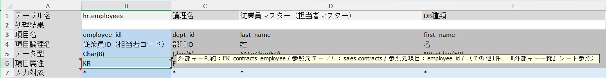

### データ取り込み結果列（テーブル項目列右端2列）

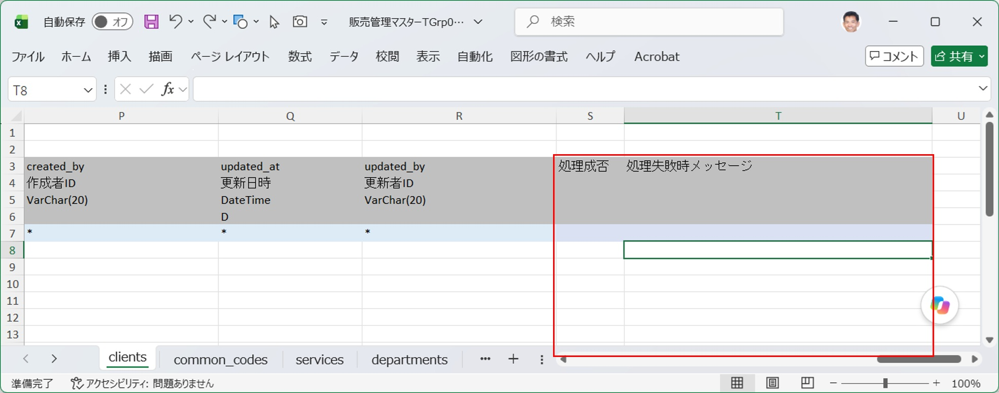

データ入力エリアの項目列の右端の2列がデータ取り込みの処理結果が記入されるエリアです。
[データ取り込み機能](/ja/docs/features/input-sheet/data-import/)処理の結果とエラーが発生した場合の利用を記入するエリアです。

| 列 | 内容 |
|---|---|
| 処理成否(テーブル項目列右端から1列目) | データ取り込み処理の成否をtrueまたはfalseで表す |
| 処理失敗時メッセージ(テーブル項目列右端から2列目) | データ取り込みがエラーになった場合、その原因を表示する。 表示内容は、データ取り込みダイアログの「エラーメッセージスタイル」の設定による（原因の説明またはDBのメッセージ。実行されたSQLは設定がONの場合のみ併記） |

※エラーの原因となった項目のデータ入力セルは、薄い赤（#FFD5D5）で着色されます。取り込みを再実行すると、前回のエラー色は消えます。詳しくは [データ取り込みダイアログの「エラーのセルの着色」セクション](/ja/docs/features/io-operations/data-import-dialog/#エラーのセルの着色) を参照してください。

※実際の書き込み例は [データ取り込みダイアログ](/ja/docs/features/io-operations/data-import-dialog/) の「処理結果の書き込み」を参照。

### データ入力エリア（8行目以降）

項目ヘッダより下がデータの入力エリアです。[入力シートへのデータ投入方法](/ja/docs/data-entry/) で紹介したいずれかの方法でデータを入力します。 
また、入力エリアの先頭から開始する行で、A列に C（または c）が連続して記入されている行はSQExcelでは「検索条件行」として取り扱われデータ取込み時の入力データ対象外となります。 
詳細については [データ出力機能](/ja/docs/features/input-sheet/data-export/) の「検索条件からWHERE句を組み立てる」を参照してください。

## テーブルシートのデータ型とセル書式の対応

入力シート作成時、テーブル項目のデータ型に応じて、Excel のセル書式が自動的に設定されます。主な対応は次の通りです（詳細な桁数範囲や既定値は [入力シート作成ダイアログ](/ja/docs/features/io-operations/input-sheet-builder-dialog/) のワークシート設定タブ・列幅設定タブで調整できます）。

| データ型カテゴリ | 対応するセル書式 |
|---|---|
| 整数型（TinyInt/SmallInt/Int/BigInt） | <strong>標準（General）</strong>、または整数表示 |
| 固定小数点型（Decimal/Numeric） | 桁数に応じた小数点表示（例：`0.0000`） |
| 浮動小数点型（Float/Real/Double） | <strong>標準（General）</strong>、または誤差を抑えた固定桁表示 |
| 文字列型（Char/VarChar/Text/Clob 等） | 標準（General）、または<strong>文字列（`@`）＋折り返して全体を表示</strong> |
| 日付・時刻型（Date/Time/DateTime 等） | 日付書式は<strong>`yyyy/mm/dd`</strong> 等、時刻書式は<strong>`hh:mm:ss`</strong> 等、複数の書式から選択可 |
| 真偽値型（Bit/Boolean/Number1 等） | 標準（General） |
| バイナリ型（Binary/Blob/Bytea 等） | 標準（General）、また<strong>は文字列（`@`）＋折り返して全体を表示</strong>（16進数文字列） |
| その他（Guid/Xml/Json/RowId 等） | 標準（General）、または<strong>文字列（`@`）＋折り返して全体を表示</strong> |

※既定の書式は太字で表示されています。 
※`@`はセルの書式が文字列に設定されていることを示す記号です。 

- 数値型、日付型項目のデータ入力例
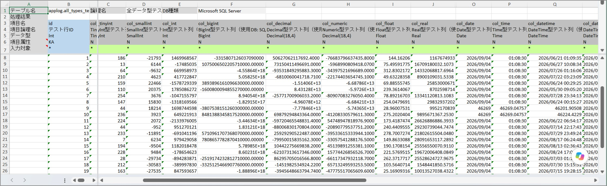

- 文字型項目のデータ入力例
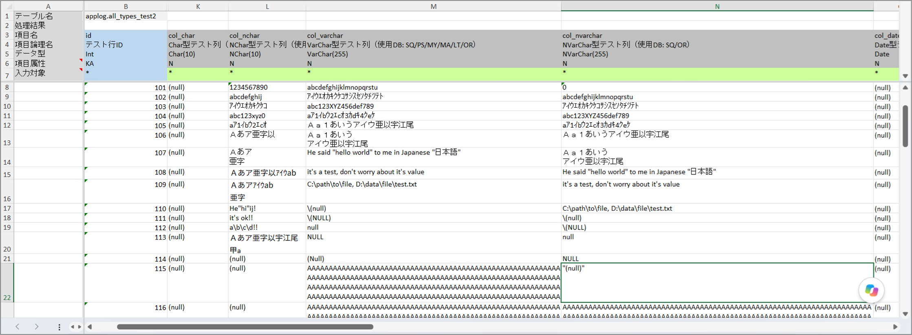

- バイナリ型、BLOB型データの入力例
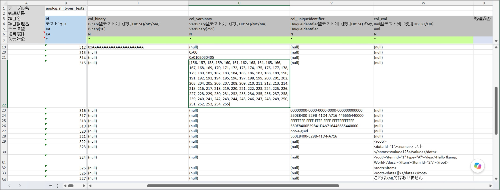

:::tip[列幅もデータ型に応じて自動調整]
例えば `Char/VarChar` 等の文字列型は桁数帯（1〜10／11〜20／21〜）ごとに既定の列幅が設定されており、`Decimal/Numeric` も桁数帯によって列幅が変わります。詳細な対応表は [入力シート作成ダイアログの列幅設定タブ](/ja/docs/features/io-operations/input-sheet-builder-dialog/#列幅設定タブ) の列幅設定タブで確認・変更できます。
:::

## 外部キー一覧シート
テーブルシートとは別の、参照用のシートです。ブックの最後尾に1枚作成され、データ取り込み・データ出力の対象にはなりません。 
入力シートに含まれるテーブルに関係する外部キー制約（テーブル間の参照関係）を、1項目1行で一覧にします。DB定義書がなくても、「どのテーブルのどの項目が、どのテーブルのどの項目を参照しているか」をこのシートだけで確認できます。

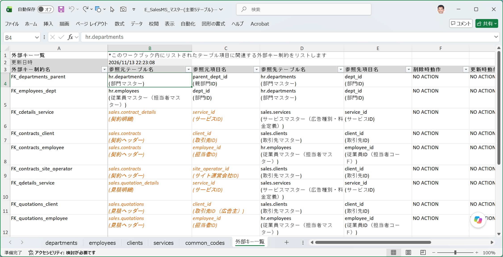

### 外部キー一覧表の項目

  列 | 見出し | 内容 | 値の例 |
|---|---|---|---|
| A | 外部キー制約名 | 制約の名前です。※制約名を持たない SQLite では `(無名)` と表示されます。 |`FK_sales_details_product` |
| B | 参照元テーブル名 | 外部キーを持つ（参照する側の）テーブルです。`スキーマ名.テーブル名` の形式で表示されます。 |`sales.sales_details` |
| C | 参照元項目名 | 参照する側の項目です。複合キーの場合は、構成する項目ごとに1行になります。 | `product_code` |
| D | 参照先テーブル名 | 参照される側のテーブルです。`スキーマ名.テーブル名` の形式で表示されます。 | `sales.products`|
| E | 参照先項目名 | 参照される側の項目です。 | `product_code` |
| F | 削除時動作 | 参照先の行を削除したときの動作です（下表参照）。 | `CASCADE` |
| G | 更新時動作 | 参照先のキー値を更新したときの動作です（下表参照）。 | `NO ACTION` |
| H | 状態 | 制約の状態で、`有効`／`無効`／`未検証` のいずれかです。`未検証`は、新規データには適用されるが、既存データは検証されていない制約を指します。MySQL・MariaDB・SQLite は常に `有効`です。 | `有効` |
| I | Book外か？ | 参照元または参照先のテーブルが、このブックの入力シートに含まれない場合に `TRUE` になります。 |`FALSE` |
| J | 循環 | その制約が循環参照（外部キーが互いに輪のように参照し合う関係）を構成している場合に `TRUE` になります。 |`FALSE` |

#### 記入例
  販売明細トランザクション（`sales.sales_details`）の商品コードが、商品マスター（`sales.products`）の商品コードを参照している場合、次のように表示されます。

| 参照元テーブル名 | 参照元項目名 | 参照先テーブル名 | 参照先項目名 |
|---|---|---|---|
| `sales.sales_details` （販売明細トランザクション） | `product_code` （商品コード） |`sales.products` （商品マスター）| `product_code` （商品コード） |

※物理名の下の行に、括弧で囲んで論理名が表示されます。論理名が設定されていないテーブル・項目は、物理名のみが表示されます。

### 論理名の表示

B〜E列（テーブル名・項目名）には、論理名が設定されていれば、物理名の下の行に `(論理名)`の形式で併記されます。論理名の表示は標準の動作で、設定を切り替える必要はありません。

- 参照元・参照先がブックの入力シートに含まれていないテーブル・項目も、論理名が設定されていれば併記されます。
- 論理名の取得に失敗した場合は、論理名なしで一覧の作成が続行されます。この場合のエラーはログに記録され、[診断情報の保存](/ja/docs/〈診断情報の保存ページのパス〉/) で確認できます。
- 項目属性セルのメモには論理名は表示されません（物理名のみ）。参照関係の詳細は、リンクから一覧シートへ移動して確認してください。
- 「追加のみ」では既存の行は書き換えられません。既存の一覧のすべての行に論理名を付けたい場合は、「追加＋外部キー情報更新」または「外部キー情報更新のみ」で作り直してください。

### 削除時動作・更新時動作に表示される値

| 値 | 意味 |
|---|---|
| `NO ACTION` | 参照している行が残っていると、参照先の削除・更新はエラーになります。 |
| `RESTRICT` | `NO ACTION` とほぼ同様に、参照している行が残っていると参照先の削除・更新を拒否します。 |
| `CASCADE` | 参照先の削除・更新に連動して、参照元の行も削除・更新されます。 |
| `SET NULL` | 参照先の削除・更新に連動して、参照元の項目が NULL になります。 |
| `SET DEFAULT` | 参照先の削除・更新に連動して、参照元の項目が既定値になります。 |
| `—`（更新時動作のみ） | Oracle には更新時動作がないため、`—` と表示されます。 |
| 空白（削除時動作のみ） | DBから動作を取得できなかった場合は空白になります。 |

### Book外のテーブル・項目の表示

参照元と参照先の片方だけがブックの入力シートに含まれていない制約も、一覧に掲載されます（両方がブック外の制約は掲載され
ません）。 
ブック外のテーブル名・項目名は、**濃いオレンジ色の斜体文字**で表示されます。

- 参照元がブックにない場合：参照元テーブル名・参照元項目名（B列・C列）が斜体になります。
- 参照先がブックにない場合：参照先テーブル名・参照先項目名（D列・E列）が斜体になります。

斜体の項目がある行は、I列（Book外か？）が `TRUE` になります。

### シート上部の情報

- B2セル：更新日時。C2/D2セル：「追加のみ」モードでの一部変更の日時。 
作成・更新の詳細は [入力シート作成](/ja/docs/features/io-operations/input-sheet-builder-dialog/) を参照してください。

## ワークシート保護

テーブル情報ヘッダ・項目ヘッダ部まではセルロックがかけられ、データ入力エリアはロック対象外となった状態でワークシート保護がかけられます（保護の有無は入力シート作成ダイアログで設定可能）。ロックされた範囲でもセルの書式変更・行列の挿入削除・並べ替え・オートフィルターは許可されており、実質的にピボットテーブルの使用とシナリオの編集以外はすべて操作可能です。

- ワークシート保護解除用のパスワードは設定されません。 
(従って解除するときにパスワードを入力する必要はありません。)
- ワークシート保護が有効な状態で、セルがロックされている項目ヘッダ内のセル値を変更しようとするとエラーが表示されます。

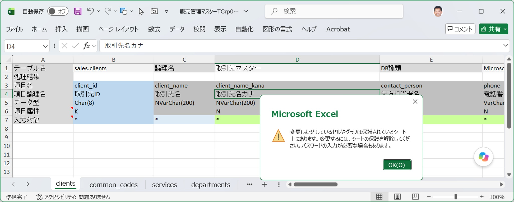

- 外部キー一覧シートも保護されます（パスワードなし）。保護中でも、次の操作ができます。
   - セルの選択、オートフィルターによる絞り込み
   - 列幅の変更、列全体の表示／非表示（列の書式設定）
   - 図形（吹き出しなど）や任意のマークの貼り付け・編集（オブジェクトの編集）
   - ヘッダ部（1〜3行目）と外部キー情報の行（A〜J列）以外のセルへの、メモなどの書き足し

ヘッダ部と外部キー情報のセルはロックされていて、編集できません。 
なお、外部キー情報を更新して一覧シートを作り直す場合（「追加＋外部キー情報更新」「外部キー情報更新のみ」、および上書き）は、書き足した内容や貼り付けた図形は消えます。「追加のみ」では残ります。 
項目属性セルからのリンク移動は、保護中でも行えます。ユーザーが独自にパスワードを掛けた場合の更新時の扱いは[入力シート作成](/ja/docs/features/io-operations/input-sheet-builder-dialog/) を参照してください。

:::note[長いテーブル名の扱い]
ワークシート名は最大31文字です。テーブル名が30文字以上の場合、先頭29文字で切り、30・31文字目に2桁の16進数連番（`01`〜`FF`）を接尾辞として付与します。データ取り込み・出力時のテーブル照合はワークシート名ではなく、後述のテーブル情報ヘッダの値で行われるため、この省略によって処理が誤動作することはありません。
:::

