[IO操作画面](/ja/docs/features/io-operations/) で「データの取り込み」ボタンをクリックすると、データの取り込みダイアログが開きます。データが入力された入力シートを元に SQL を生成し、データベースへ反映します。

## データ取り込みダイアログ画面構成

### ダイアログ全体図

   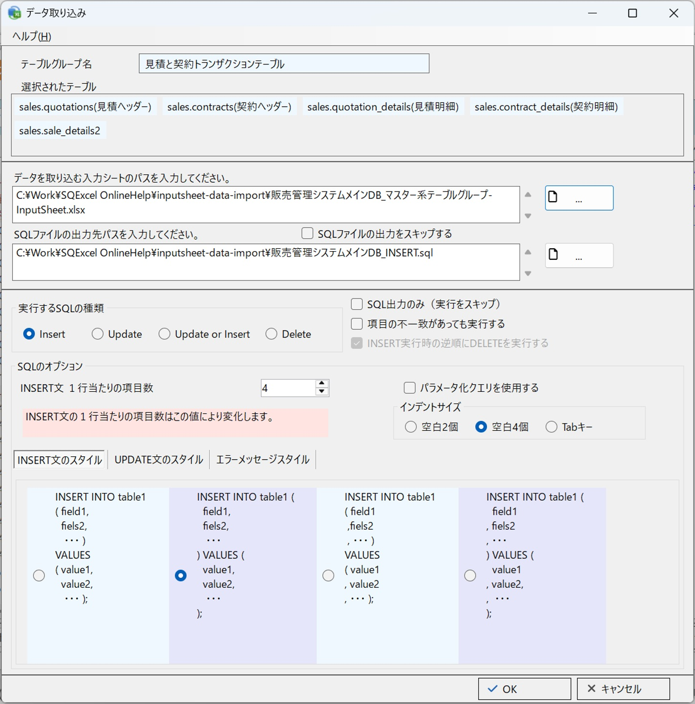

:::tip[データ取り込みの処理種類]
SQExcelのデータ取り込みで実行する処理の種類は、SQLによるデータ更新処理の INSERT／UPDATE／UPDATE or INSERT（UPSERT）／DELETE の4種類です。DELETE（削除）処理もデータ取り込みに含めるのは、少し違和感があるかもしれません。ここでは「入力シートからデータを**取り込んで**、それを元にDBテーブルに対して何らかの処理を行う」のがデータ取り込み機能である、とご理解ください。
:::

### ダイアログ上部

   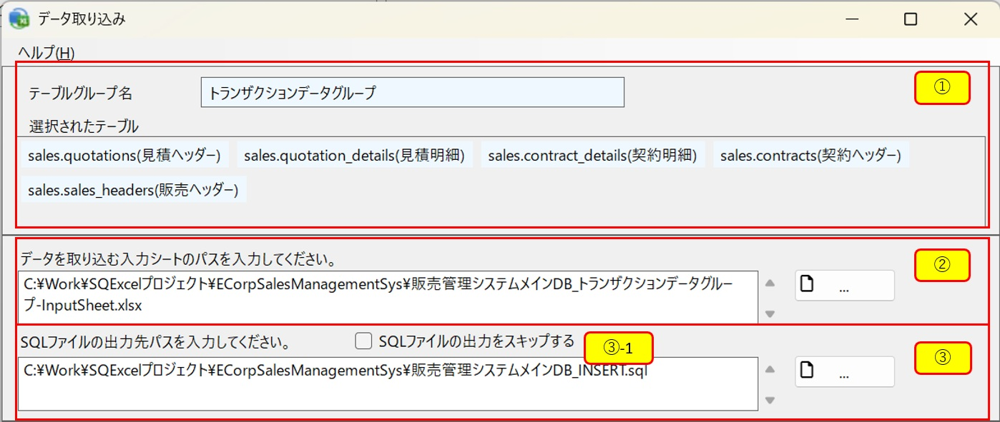

| No. | エリア | 内容 |
|---|---|---|
| ① | テーブルグループ情報パネル | 呼び出し元の IO操作画面で選択されていたテーブルグループ名と、選択済みテーブルの一覧を表示します |
| ② | 入力シートのパス入力欄 | データ取り込み元となる入力シートのパスを指定します（アプリDBごとに記憶されます） |
| ③ | 出力するSQLファイルのパス入力欄 | 実行したSQLを保存するファイルのパスを指定します（アプリDBごとに記憶されます） |
| ③-1 | SQLファイル出力スキップ | ONにすると、SQLの実行のみを行いファイルへの保存を省略します。 ※読み取り専用の接続ではOFFで固定されます（[読み取り専用の接続が選択された場合参照](#読み取り専用の接続が選択された場合)）|

### ダイアログ中間部

   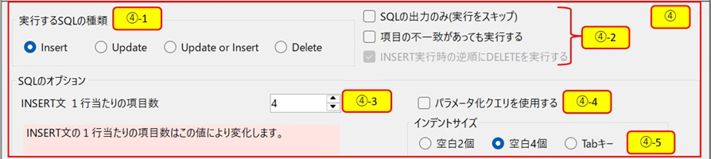

| No. | エリア | 内容 |
|---|---|---|
| ④ | データ取り込みオプションパネル | データ取り込み処理の各種オプションの設定入力エリアです |
| ④-1 | SQLの種類 | 実行する処理種類をINSERT／UPDATE／UPDATE or INSERT（UPSERT）／DELETE から選択します |
| ④-2 | SQL出力のみ | ONにすると、SQLファイルを出力するだけで実際の実行は行いません（入力シートの処理結果・処理失敗時メッセージも更新されず、エラーセルの着色も行いません）。 ※読み取り専用の接続では、ONのまま固定されます。（[読み取り専用の接続が選択された場合参照](#読み取り専用の接続が選択された場合) |
| "" | 項目に不一致があっても実行する | 入力シートとテーブルの項目が完全に一致しなくても、一致する項目だけでSQLを生成して実行します |
| "" |DELETE時にテーブル順・行順を逆順にする | SQLの種類がDELETEのときのみ操作可能。詳細は [外部キー参照のあるテーブルへのデータ挿入及び削除手順（重要）](/ja/docs/data-entry/foreign-key-order/) を参照 |
| ④-3 | INSERT文1行当たりの項目数 | 1〜10の範囲で指定します |
| ④-4 | パラメータ化クエリを使用する | SQLインジェクション対策としてパラメータ化クエリを使用するかどうかを指定します。「SQLファイル出力スキップ」がONの場合でも常に操作可能です（エラー時に入力シートへ併記するSQL（④-10）の表示書式にも影響するため） |
| ④-5 | インデントサイズ | SQL生成時のインデント幅を指定します |

### INSERT文とUPDATE文のスタイルタブ

   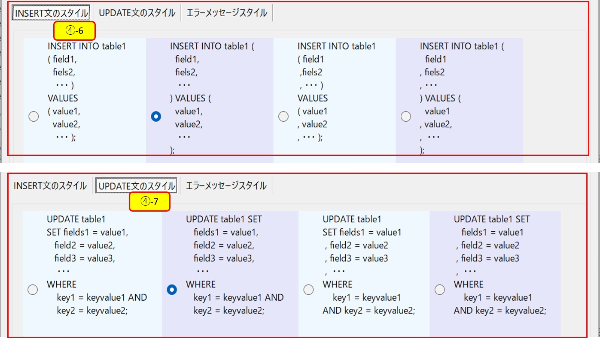

| No. | エリア | 内容 |
|---|---|---|
| ④-6 | INSERT文のスタイル | 項目リストや値リストの前後に付ける()の位置、及び各項目の区切りの「,」の位置を4つのパターンから選択します |
| ④-7 | UPDATE文のスタイル | SET句の位置、項目値設定句の「,」の位置、及びWHERE句内のAND/ORの位置を4つのパターンから選択します |

- それぞれのスタイルを選択したときに生成されるSQLの具体的な書式は [データ取り込みの詳細](/ja/docs/features/input-sheet/data-import/#insert文update文のスタイル) で例示しています

### エラーメッセージスタイルタブ
データ取り込みでエラーになった行について、入力シートの「処理失敗時メッセージ」列に何を出力するかを指定します。INSERT文・UPDATE文のスタイルと同じタブ領域の3つ目のタブです。

   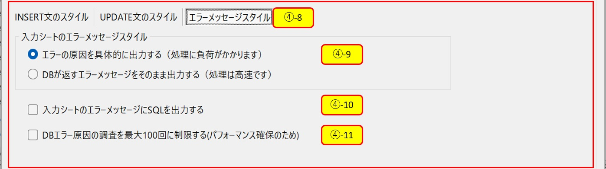

| No. | エリア | 内容 |
|---|---|---|
| ④-8 | エラーメッセージスタイルタブ | エラーメッセージの出力方式を指定するタブです |
| ④-9 | 出力方式 | **「エラーの原因を具体的に出力する」（既定）**：エラーになった行の原因を調べ、項目・値・参照先を示すメッセージを出力し、原因のセルを着色します。原因の調査のため処理に負荷がかかります。 **「DBが返すエラーメッセージをそのまま出力する」**：DBのメッセージをそのまま出力します。処理は高速ですが、DBの種類・言語ごとの専門的なメッセージになります。|
| ④-10 | 入力シートのエラーメッセージにSQLを出力する | ONにすると、エラーメッセージの後に実行したSQLを併記します。既定はOFFです（SQLを併記するとセルが縦長になり読みにくくなるため）。「SQL出力のみ」がONのときは使用できません |
| ④-11 | DBエラー原因の調査を最大100回に制限する | ONにすると、DBへの問い合わせを伴う原因調査を、1回の取り込み全体で最大100行までに制限します（エラーが大量に出ても処理が長引かないように）。既定はONです。「エラーの原因を具体的に出力する」かつ「SQL出力のみ」がOFFのときだけ使用できます |

- ここでの設定は、次回以降のダイアログにも引き継がれます。

## 本番環境と読み取り専用の接続に対するデータ取り込み

本番環境のような厳格なデータ管理を行う接続に対しては、社内ルールや業務規約により入力シートからの直接データベースに対するデータ更新が禁止される場合が想定されます。このような場合は接続の設定で読み取り専用フラグをONにします。
 
また読み取り専用フラグがOFFであっても接続の環境が「本番」である場合にはより厳密に操作の確認がユーザーに求められます。
 
それぞれの場合におけるデータ取り込みダイアログ画面の操作方法を示します。

### 読み取り専用の接続が選択された場合

読み取り専用の接続に対してデータ取り込みを実行すると、ダイアログ画面からデータベースに対する直接のデータ登録・変更・削除は実行できなくなり、SQLスクリプトの出力のみが実行できるようになります。

   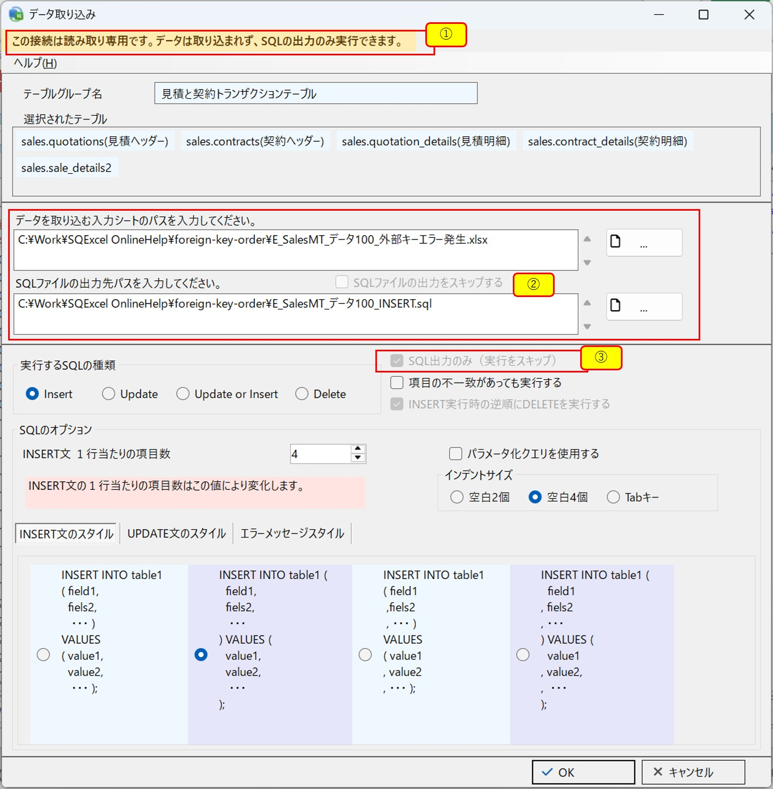

- ダイアログ最上部に琥珀色の案内帯「この接続は読み取り専用です。データは取り込まれず、SQLの出力のみ実行できます。」が表示されます（①）。
- 「SQL出力のみ」がONで固定され（②）、「SQLファイル出力スキップ」はOFFで固定されます（③）。SQLファイルを出力するだけで、DBには書き込みません。入力シートと出力するSQLファイルのパス入力欄の使用方法は変わりません。
- 処理結果列は更新されません（「SQL出力のみ」の通常の動作と同じです）。
- 書き込みたいときは、ホーム画面の接続設定で「読み取り専用」のチェックを外して登録してください。
本番の接続を読み取り専用にして「SQL出力のみ」で手順書用のSQLを作る、という使い方もできます。

### 本番環境の接続での取り込み
環境が「本番」で、書き込み可能な接続に対して「SQL出力のみ」以外で取り込む場合は、ダイアログ最上部に赤い帯が表示されます。 
「本番環境: 接続名 / サーバー / DB ｜ 処理: INSERT」（処理は選択中のSQLの種類に追従します）。

   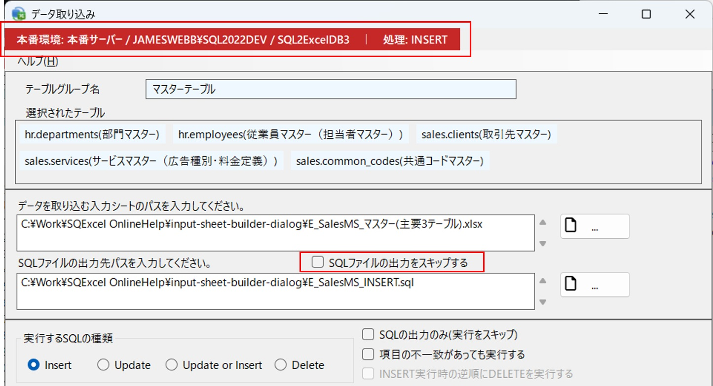

- 「SQL出力のみ」をONにすると、赤帯は消えます（DBへ書き込まないため）。

   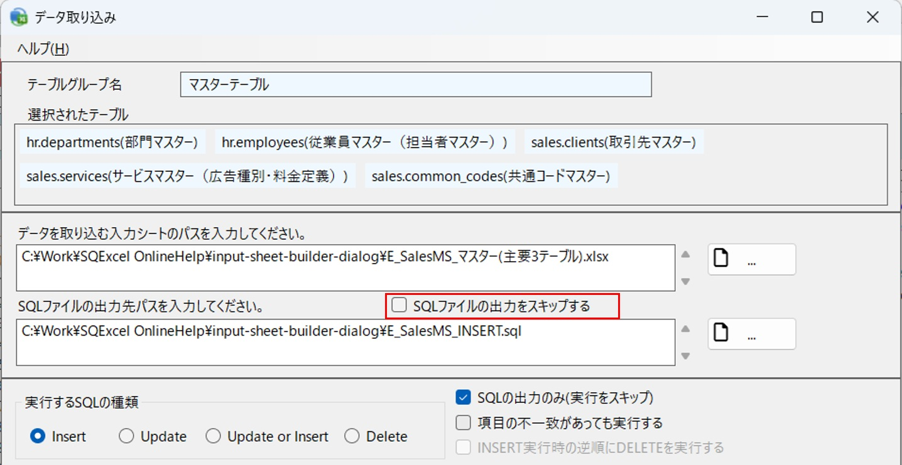

- 確認用のチェックボックスやボタンの制御はありません。帯の内容を読んで接続先を確認してから［OK］をクリックしてください。

### 読み取り専用の接続に対して取り込みが要求された場合
読み取り専用の接続に対して、「SQL出力のみ」以外の取り込みが要求されたときは、「接続「○○」は読み取り専用に設定されているため、データを取り込めません（「SQL出力のみ」は実行できます）。」と表示され、処理は開始されません。
 
※ 通常は画面で固定されるため、このメッセージは表示されません。

## データ取り込みとSQLファイル出力

1. データ取り込みダイアログでは、取り込み対象の入力シートを指定すると、既定で入力シートと同じフォルダに実行されるSQLスクリプトファイルを出力します。既定のSQLファイル名は、入力シート名の先頭から最後に現れる `_`（アンダースコア）までを切り取り、末尾に実行するSQLの種類（INSERT／UPDATE／UPSERT／DELETE）を付けたものになります。

   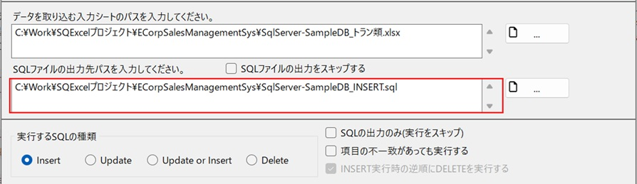

2. SQLファイルの出力が不要な場合は、「SQLファイル出力スキップ」チェックボックスをONにします。これにより、SQLファイルの出力先パス入力欄と「SQL出力のみ（実行をスキップ）」チェックボックスは使用できなくなります。

   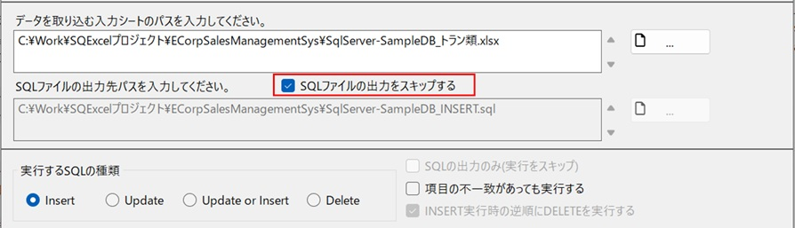

    - このオプションを使用するのは、開発環境やテスト環境でテストデータを手早く投入したり削除したりする場合です。

3. 逆に、SQLファイルの出力のみを行い、入力シートから直接データ取り込みを行うのを禁止する場合は、「SQL出力のみ（実行をスキップ）」チェックボックスをONにします。

   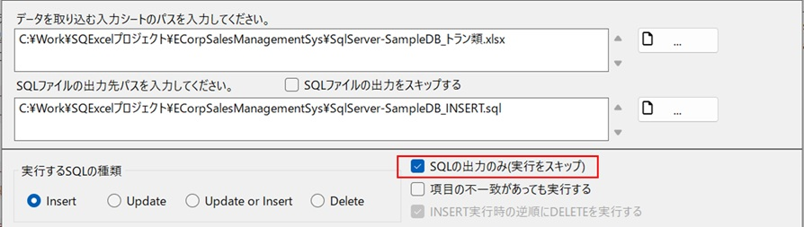

    - このオプションを使用するのは、本番環境などSQExcelから直接データベースへ接続しない環境向けに、SQLスクリプトだけを作成してリリース手順に乗せたい場合です。

    - 本番環境への接続を「読み取り専用」にしておけば、誤って本番環境のDBへのデータ取り込みを実行することなくSQLスクリプトだけを作成できます。この場合、「SQL出力のみ」を毎回ONにする必要はありません（自動で固定されます）。

## 処理結果の書き込み

処理が完了すると、入力シートの各行の「処理成否」列・「処理失敗時メッセージ」列に結果が書き込まれます。テーブルごとの処理結果表示エリア（B2セル）には、成否のメッセージに加えて**実行したSQLの種類（INSERT／UPDATE／UPSERT／DELETE）のラベル**が先頭に付与されます。

### INSERT処理が成功した入力シートの処理結果

   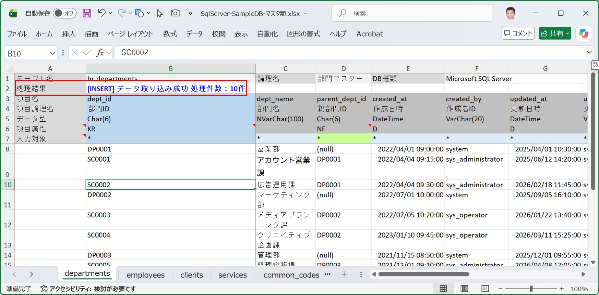

### DELETE処理が成功した入力シートの処理結果

   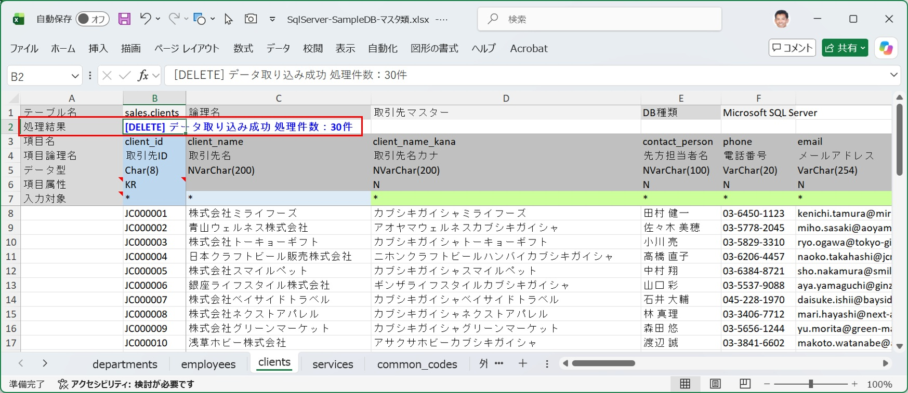

### 取り込みエラーが発生した入力シートの処理結果

入力シート上で取り込みエラーとなった行は処理成否がFALSEとなり、処理失敗時メッセージが表示されます。

   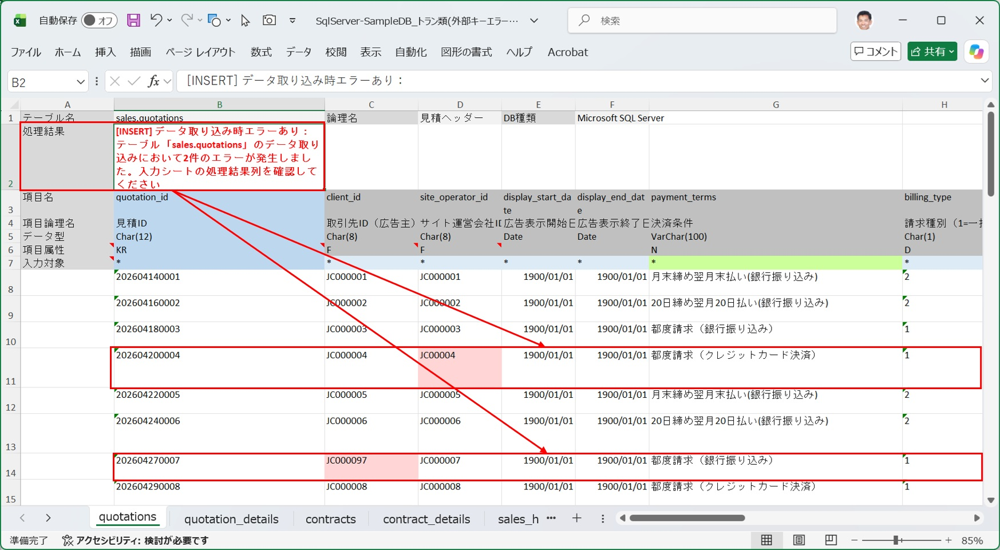

処理失敗時メッセージの内容は、[エラーメッセージスタイルタブ](#エラーメッセージスタイルタブ)の設定によって変わります。既定（エラーの原因を具体的に出力する）では、エラーの原因を説明するメッセージが表示され、原因となった項目のセルが薄い赤で着色されます。

   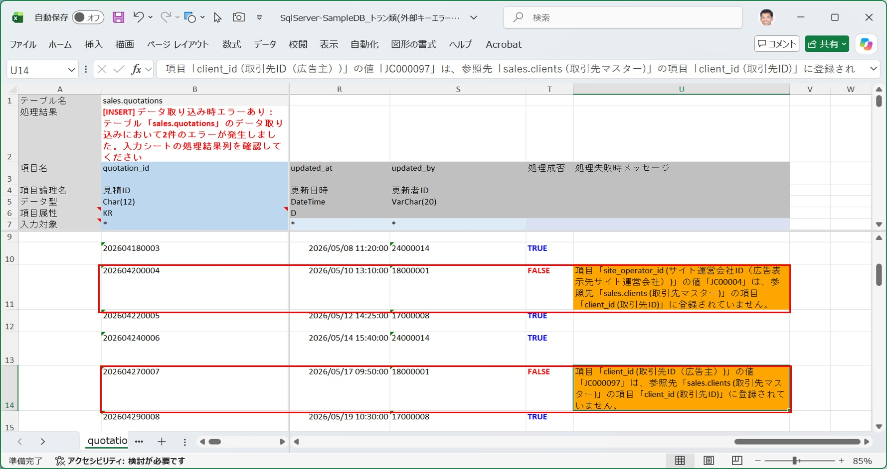

 
「DBが返すエラーメッセージをそのまま出力する」を選んだ場合は、DBが返したメッセージが表示されます。
実行されたSQLスクリプトは、「入力シートのエラーメッセージにSQLを出力する」がONの場合のみ併記されます。

   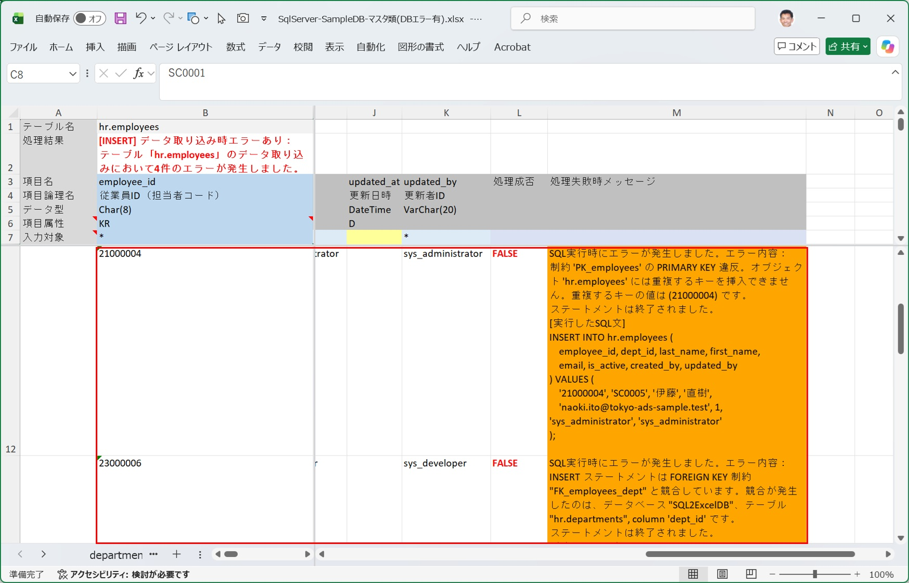

### エラーメッセージの内容
「エラーの原因を具体的に出力する」を選んだとき、エラーの原因ごとに次のようなメッセージが表示されます。（項目名は「物理名 (論理名)」で表示されます）

| 原因 | 表示されるメッセージの例 |
|---|---|
| 値が入っていない（NULLにできない項目） | 項目「req_name (必須名称)」に値がありません（NULLにできない項目です）。 |
| 桁数オーバー | 項目「short_text (短い文字列)」の値は文字数 5 を超えています（6 文字）。 |
| 値の型が合わない | 項目「qty (数量)」の値「abc」は Int 型として認識できません。 |
| 主キーの重複（INSERT） | 項目「id (子ID)」の値「1」は既に登録されています（主キーの重複）。 |
| 重複できない項目の重複（UNIQUE） | 項目「uq_code (一意コード)」の値「U001」は既に登録されています（重複できない項目です）。 |
| 外部キー：参照先に登録されていない | 項目「parent_id (親ID)」の値「999」は、参照先「applog.emt_parent」の項目「id (親ID)」に登録されていません。 |
| 外部キー：削除しようとしたデータが参照されている（DELETE） | このデータは「applog.emt_child」の項目「parent_id (親ID)」から参照されているため削除できません。 |
| CHECK制約を満たさない | 項目「qty (数量)」の値「-1」は、チェック条件「([qty]>=(0))」を満たしていません。 |

- 原因が複数ある場合は、改行で区切って表示します。外部キーの違反が複数ある場合は、すべて表示します。
- 原因を特定できない場合は、DBが返したメッセージを表示します。
- 値の型が合わない場合と、文字数・バイト数の上限を超える場合は、どちらの出力方式でも項目名つきのメッセージを表示し、該当のセルを着色します。

### エラーのセルの着色
「エラーの原因を具体的に出力する」の場合、エラーの原因となった項目のセルが薄い赤（#FFD5D5）で着色されます。

   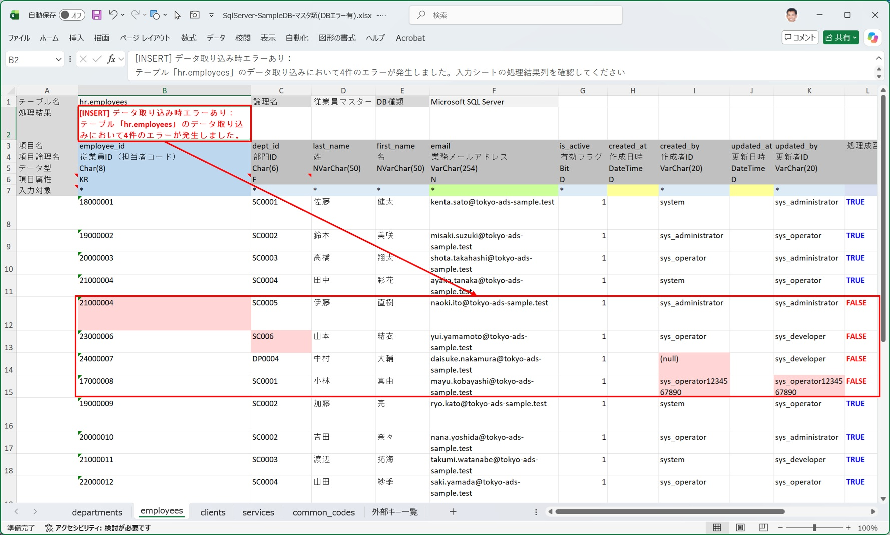

- 修正して取り込みを再実行すると、前回のエラー色は自動的に消えます。ご自身で付けた色や枠線は変わりません。（エラーのセルに元々別の色を付けていた場合は、修正後に塗りつぶしなしになります）
- データ入力エリアをロックして保護している入力シートでは、セルを着色できません。この場合は着色せず、B2セルに「データ入力エリアが保護されているためエラー値が設定されたセルの背景色を変更できません。」と表示します。
- 「SQL出力のみ」の取り込みでは、処理結果・メッセージの記入と着色は行いません。

### DBエラー原因の調査について
「エラーの原因を具体的に出力する」では、DBがエラーを返した行についてだけ、原因を調べます。主キー・UNIQUE・外部キーの調査は、DBへ問い合わせて存在を確認するため、処理に時間がかかります。

- 「DBエラー原因の調査を最大100回に制限する」がONの場合、DBへの問い合わせを伴う調査は、1回の取り込み全体で100行までです。（値が入っていない・桁数オーバー・CHECK制約は、DBへの問い合わせが不要なため制限されません）
- 上限に達した行は、DBのメッセージの後に「原因調査の上限（100件）に達したため、DBのメッセージを表示しています。」と表示します。
- 大量の行がエラーになる場合（例：入力シートの別の項目に値を入れ間違えた）は、先に入力シートを見直してください。OFFにすると、すべてのエラー行を調べるため時間がかかります。
- 調査中にデータベースへの問い合わせに失敗した場合は、取り込みを続けて、DBのメッセージを表示します。

### データベースの種類による違い
エラーの原因の表示は、データベースの種類によって次の違いがあります。

| 項目 | 内容 |
|---|---|
| CHECK制約違反 | SQL Server・PostgreSQL・Oracleは原因を表示し、セルを着色します。MySQL・MariaDB・SQLiteはDBのメッセージをそのまま表示します |
| 空欄の文字列セル | Oracleは空文字列をNULLとして扱うため、NULLにできない項目では「値がありません」になります。他のデータベースは空文字列として登録できます |
| 桁数オーバー | SQLiteは桁数を強制しないため、エラーになりません。MySQL・MariaDBは、サーバーが厳格モードでないと値が切り詰められ、エラーになりません。SQL Server・Oracleの文字列は桁数がバイト単位のため、文字数は収まるがバイト数が超える場合は、DBのメッセージが表示されます |
| 論理名 | 項目や参照先の論理名は、データベースのコメントから取得します。SQLiteにはコメントがないため、物理名のみ表示します |
| 参照先の名前 | Oracleは参照先のテーブル名・項目名が大文字で表示されます |

### テーブルとワークシートの項目・型不一致でエラーになる場合

「項目に不一致があっても実行する」がOFFの状態で入力シートとテーブルの項目・型の不一致によるエラーの場合は、処理結果欄に具体的に不一致となった項目情報を表示します。

   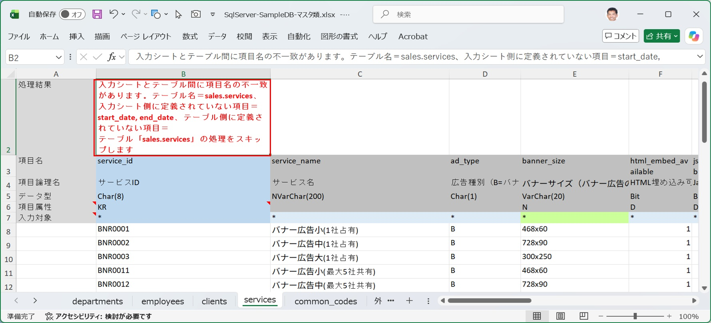

入力シートの取り込みがスキップされた場合は処理成否列と処理失敗時メッセージ列は空白になります。

   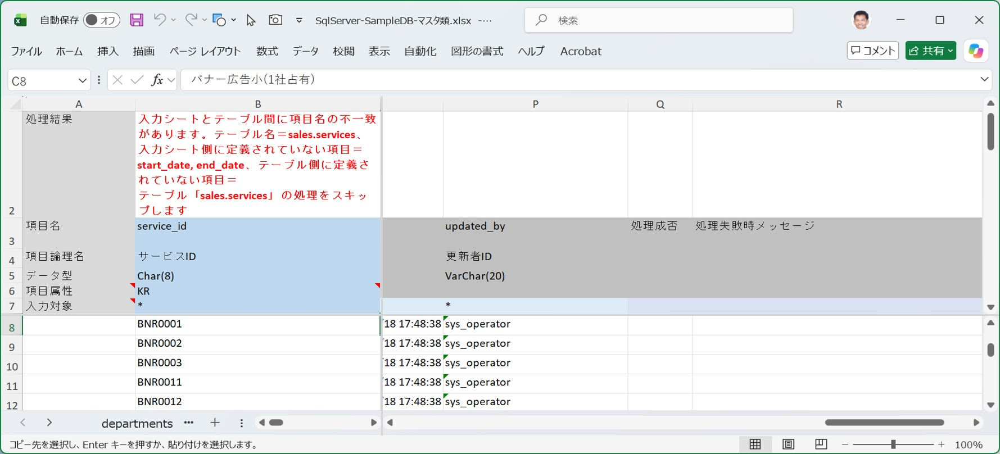

:::tip[項目・型不一致で1件も処理されなかった場合、結果表示は必ず空欄に戻ります]
「項目に不一致があっても実行する」がOFFの状態で、入力シートとテーブルの項目・型に不一致があると、そのテーブルは1行も処理されずスキップされます。このとき、B2セルには不一致の内容がエラーとして表示され、各データ行の「処理成否」列・「処理失敗時メッセージ」列は**必ず空欄・既定色にクリアされます**。前回の実行結果（例えば直前にDELETEが全件成功していた場合の `TRUE` 表示）がそのまま残ることはないため、今回の不一致に気づかず「処理は成功した」と誤解する心配はありません。 
:::

※「項目に不一致があっても実行する」がONの場合は不一致項目を除いてデータ取込み用SQLが生成され、処理は実行されます。必須入力項目が不一致項目である場合にはその入力シート全体がエラーとなります。

## データの入力ルールのポイント

### 入力シートのルール

| ルール | 内容 |
|---|---|
| 入力エリアに空白行が現れた場合 | データ取り込みを行う行をここで停止します。空白行の後方にデータが入力されている行が続いてもそれらは無視されます。 |
| 入力対象行の「*」マークを削除した項目列 | 実行するデータ処理からこの項目を除外します。実行するSQLの種類が INSERT／UPDATE／UPDATE or INSERT（UPSERT）の場合に反映されます。出力されるSQLスクリプトにもこの設定が反映されます。 |

   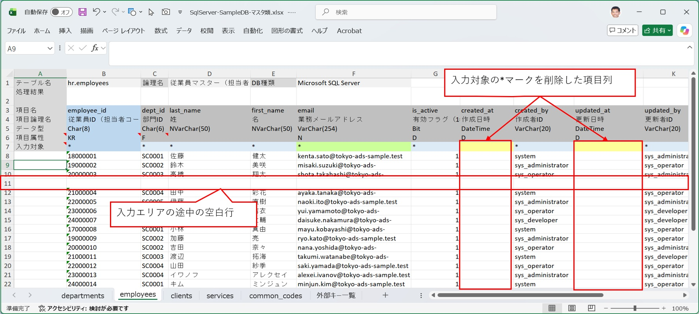

- 入力対象行の「*」マークを削除するのは、データ作成日時や更新日時のように既定値が設定される項目です。既定値が設定される項目は項目属性列に「D」が表示されます。

### 入力行セルの入力ルール

| ルール | 内容 |
|---|---|
| NULLを指定する | セルに `(null)` または `(NULL)` と入力する。あるいは項目の入力対象を外す（`*` を消す） |
| 空文字列を指定する | 文字列項目のセルに `\EMP` または `\emp` と入力する |
| 真偽値 | `TRUE` / `FALSE` / `YES` / `NO` / `1` / `0` のいずれかで入力する（大文字小文字は区別しない） |
| バイナリ（BLOB等） | 16進数文字列で入力する |

データ型ごとの入力可能な値・エラーになる値の詳しい境界は [データ取り込みと入力シート](/ja/docs/features/input-sheet/data-import/) を参照してください。
