[IO操作画面](/ja/docs/features/io-operations/) で選択済みテーブルリストにテーブルを設定した状態で「入力シート作成」ボタンをクリックすると、入力シート作成ダイアログが開き、保存先を指定したのち様々なオプションを選択できます。保存先に既存のExcelファイルを選んだ場合は、入力シート作成ダイアログに「既存ブックの扱い」タブが表示されます。 
基本的な操作の流れは [SQExcelの入力シート操作概要](/ja/docs/input-sheet-overview/) の「通常の入力シート作成を実行する場合」で説明済みです。ここでは、そこでは触れていないオプション項目の詳細を説明します。

## 入力シート作成ダイアログ画面構成

   

   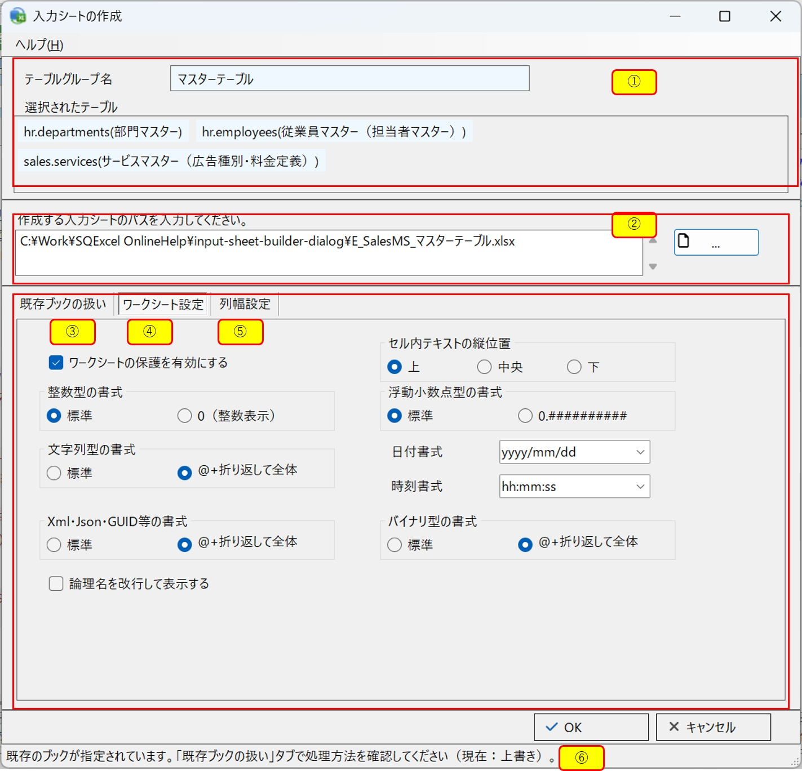

   

| No. | エリア | 内容 |
|---|---|---|
| ① | テーブルグループ情報パネル | 呼び出し元の IO操作画面で選択されていたテーブルグループ名と、選択済みテーブルの一覧を表示します |
| ② | 入力シートのパス入力欄 | 作成する入力シートの保存先パスを指定します。ファイル参照ボタンで保存先を選択できます |
| ③ | 既存ブックの扱いタブ | 出力先が既存ファイルのときだけ先頭に表示されます。上書き／追加＋更新／更新のみ／追加のみ、およびバックアップの設定を行います |
| ④ | ワークシート設定タブ | データ型ごとのセル書式（数値表示形式・日付書式など）を設定します |
| ⑤ | 列幅設定タブ | データ型・桁数ごとの入力エリアの列幅を設定します |
| ⑥ | ステータスバー | ダイアログ下端に、現在の処理モードを表示します |

### パスの初期値

入力シートのパス入力欄は、[**アプリDBごとに前回入力したファイルの親ディレクトリ**]+[**既定のファイル名**]が初期設定されています。ダイアログを開くたびに空欄から入力し直す必要はありません。

:::tip[既定のファイル名]
既定のファイル名は `[アプリDB名]_[テーブルグループ名]-InputSheet.xlsx` となっています。この命名規則は[オプション設定ダイアログ](/ja/docs/features/option-settings-dialog/) で変更できます。パス記憶機能はフォルダ部分のみを復元し、ファイル名は現在の命名規則に基づいて毎回再計算されます。
:::

### 既存ブックの扱いタブ
保存先に既存のExcelファイルを指定すると、ダイアログの先頭に「既存ブックの扱い」タブが表示されます。(保存先に新規ファイルを指定した場合、このタブは表示されません。)
- 既存のExcelファイルは通常はSQExcelの入力シートを指定します。複数のテーブルを指定して作成した入力シートに他のテーブルを追加したい場合、或いは一部のテーブルの定義が変更されて、そのテーブルシートだけ作り直したい場合などに修正対象となる既存の入力シートを指定します。
- 入力シートとして作成されていない任意のExcelワークブックを指定して入力シート用のテーブルシートを作成することも可能です。

   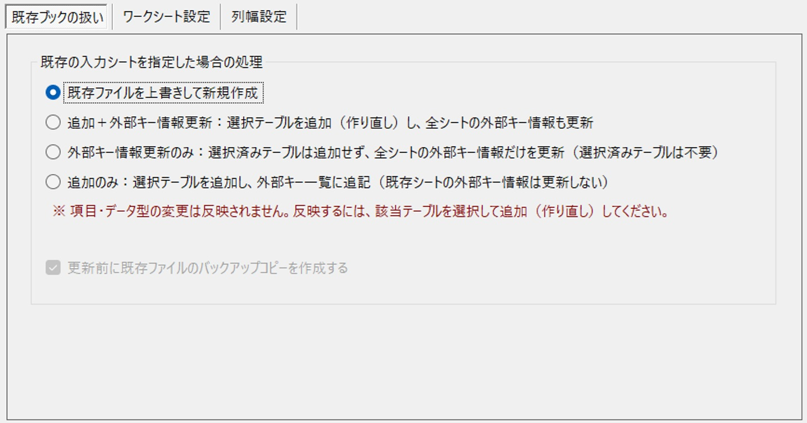

既存ブックの扱いのオプションについては [既存ブックの扱いのオプション](#既存ブックの扱いのオプション) を参照してください。

### ワークシート設定タブ

データ型カテゴリ（整数・小数・文字列・日付時刻・真偽値・バイナリ等）ごとに、生成される入力シートのセル表示形式を選択します。ここで選んだ内容は次回このダイアログを開いたときにも復元されます。

   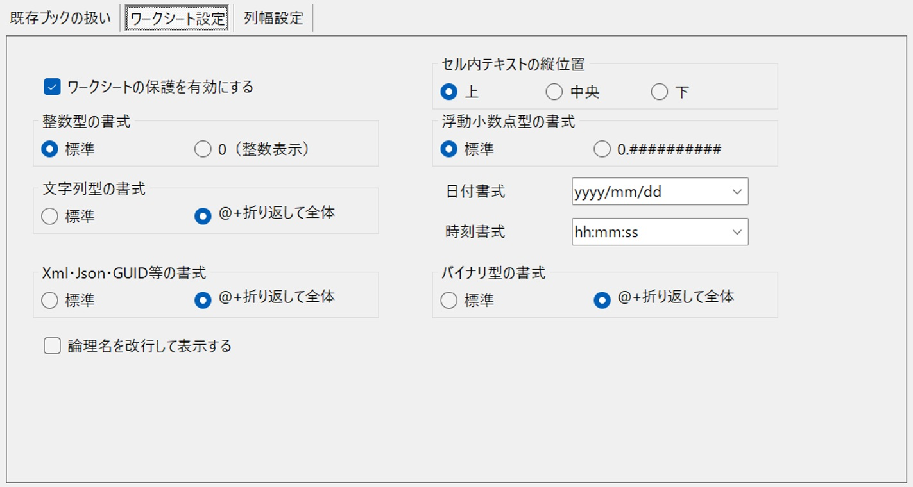

データ型とセル書式の詳しい対応表は [入力シートの構造と作成](/ja/docs/features/input-sheet/structure/#データ型とセル書式の対応) を参照してください。

### 列幅設定タブ

文字列型・数値型など、データ型と桁数帯（1〜10桁／11〜20桁／21桁以上）の組み合わせごとに、入力エリアの列幅(Excelで列幅を指定する際の単位に準拠)を設定します。

   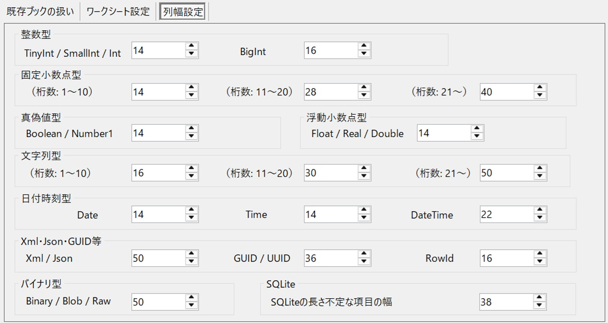

- 各データ型の列幅入力エリアの単位はExcelにおける文字数です。具体的には、標準フォント（初期設定では「11ポイントのMS Pゴシック」や「遊ゴシック」など）の半角数字の「0」が、1つのセルの中に何文字入るかを表しています。
- 固定小数点や文字列の桁数帯は、それぞれのデータ型における桁数の範囲を3つのブロック(1〜10桁／11〜20桁／21桁以上)に分けたものです。入力シートを作成する際には既定でそれぞれに割り当てられた列幅を設定しますが、その後は自由に列幅を変更することが可能です。

:::caution[入力シート作成はSQExcelの機能、データ入力は別の話]
このダイアログはあくまで「テーブル構造を反映した空の入力フォーマットを作る／更新する（外部キー情報の更新を含む）」機能です。実際にデータを書き込む方法は [入力シートへのデータ投入方法](/ja/docs/data-entry/) を参照してください。
:::

:::note[入力シート作成対象となる接続について]
- 読み取り専用の接続でも、入力シートの作成は実行できます（入力シート作成はDBを読み取るだけでデータの書き込みは実行しないため）。

- 実行時にパスワードが未入力の接続がある場合は、実行前にパスワード入力ダイアログが表示されます。キャンセルすると処理を中止します。
:::

## 外部キー情報
入力シート作成ダイアログから新規入力シートを作成するか、或いは既存の入力シートを更新する場合に、SQExcelはDBから外部キー情報を取得して入力シートに反映します。 
各テーブルシートの項目属性に外部キー制約に関するマークを行う他、入力シートに含まれるテーブルの外部キー情報を「**外部キー一覧**」シートに書き出します。 
これによりDB定義書がなくても、入力シートだけでテーブル間の参照関係を読み取ることが可能になります。
- 項目属性に **F**（外部キー参照元）・**R**（参照先）を付与します。 
メモに制約名・相手テーブル・項目を表示し、「外部キー一覧」シートへのハイパーリンクを設定します。

   

   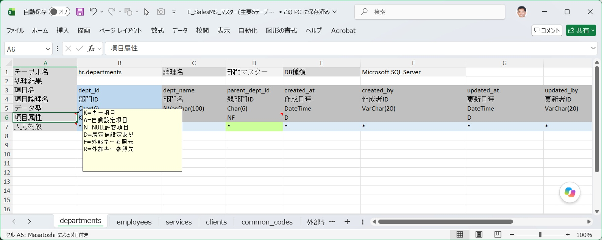

   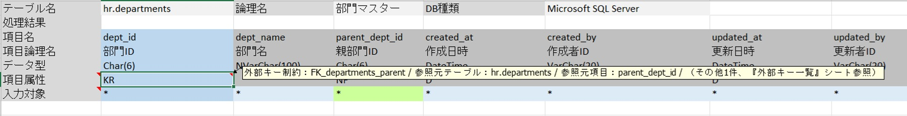

   

- 「外部キー一覧」シートは、ブックの最後尾に1枚作成されます。

   

   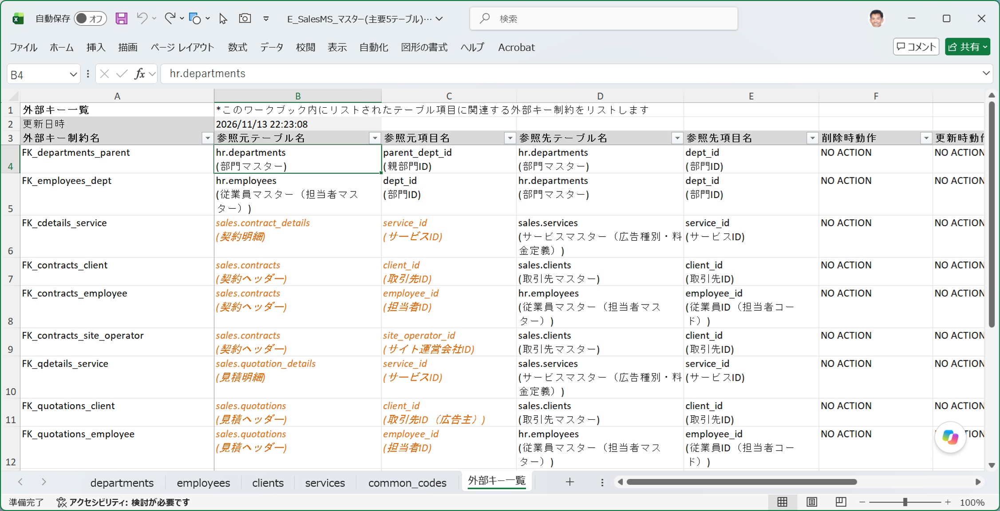

   

外部キー一覧についての詳しい構造は [入力シートの構造と作成の「外部キー一覧シート」セクション](/ja/docs/features/input-sheet/structure/#外部キー一覧シート) を参照してください。

### 外部キー情報の取得に失敗した場合
入力シート作成時に取得に失敗すると「再試行／F・Rなしで続行／中止」の3択ダイアログが表示されます。

- 「F・R(参照元・参照先情報)なしで続行」を選ぶと、F/Rは付与されず、「外部キー一覧」シートの処理結果行（2行目）のC列に赤字で「以下のエラーにより外部キー情報取得不能：…（例外メッセージ）」が記録されます。各シートの行ヘッダ・項目属性のメモにも注記されます。

- 既存ブックの追加・更新で続行した場合、既存の一覧の行は消えません（内容が古い可能性があります）。次回の取得に成功すると、エラー文は消えます。

- 「更新のみ」で取得に失敗した場合は、処理を中止します（ブックは変更されません）。

### 外部キー制約名のDB種類による違い
- SQLite：外部キー制約には制約名を付けられないため、外部キー一覧シート上の制約名は「(無名)」と表示されます。
- Oracle：更新時動作がないため「—」と表示されます。
- UNIQUE制約を参照する外部キーは、列単位で扱われます。

## 既存ブックの外部キー情報更新について

### パスワード付きシートの更新
既存ブックの外部キー情報の更新（後述）を選択したときに、入力シートまたは「外部キー一覧」シートにパスワードが掛かっている場合は、次の順に処理します。
1. パスワードなしで開けるか確認
2. 入力済みのパスワードを自動で試行
3. パスワード入力ダイアログを表示。

同じパスワードの再入力は不要です。「処理の中止」を選ぶと、何も変更せずに終了します。更新後は元のパスワード・許可操作で再保護されます。誤って入力した場合は再入力を促します。 
※これはExcelのシート保護のパスワードです。データベース接続のパスワードとは別のものです。

### その他注意事項
- 更新されるのは、各入力シートの項目属性セルの外部キー情報（F/R）のみです。データ入力エリア、K/A/N/D、A6の凡例メモには触れません。属性セルにF/R/K/A/N/D以外の文字があっても、そのまま保持されます。
- 名称が `_oldXX` のシートは更新の対象外です。
- 更新を伴うモードで途中で中止すると、ブックは保存されません（すべて実行されるか、何も実行されないかのどちらかです）。
- 外部キー情報は、取得時に接続していたDBのものです。接続先（開発／本番等）で異なる場合は、更新して使ってください。権限で参照できる範囲の制約のみ取得されます。

## 既存ブックの扱いについて
### オプション
保存先に既存のExcelファイルを指定すると、ダイアログの先頭に「既存ブックの扱い」タブが表示されます。既存のファイルの取り扱い用法は次の4つのオプションから選択します。

| オプション | ①選択テーブルのシート | ②既存の他のシート | ③外部キー一覧 | ④項目属性 |
|---|---|---|---|---|
| 既存ファイルを上書きして新規作成 | 新規作成 | 引き継がない（選択テーブルだけの新規ブックを保存） | 新規作成 | 付与 |
| 追加＋外部キー情報更新 | 追加（既存シートがあれば退避して作り直し） | 温存。ただし全入力シート・全項目の外部キー参照情報を更新 | 作り直し | 全入力シートで更新 |
| 外部キー情報更新のみ | 追加しない（選択テーブルは不要） | 温存。全入力シート・全項目の外部キー参照情報のみ更新 | 作り直し | 全入力シートで更新 |
| 追加のみ | 従来どおり追加 | 温存。既存シートは更新しない | 追記（ワークシートC2/D2に一部変更日時） | 追加したシートのみ |

- 「更新のみ」は選択テーブルが0件でも実行でき、DB接続は外部キー情報の取得にのみ使われます。 
- 外部キー参照情報は入力シートの項目属性セルにF(=外部キー参照元)/R(=外部キー参照先)として表示され、入力シート内の「外部キー一覧」シートで制約情報を参照することが出来ます。

### バックアップ
「更新前にバックアップを作成する」（既定ON）にチェックがあると、既存ブックを書き直す3モード（追加＋更新／更新のみ／追加のみ）で、書き込み直前に同じフォルダへバックアップを作成します。ファイル名は `元の名前.bak_yyyyMMdd_HHmmss.xlsx` で、同名がある場合は `_2…` が付きます。バックアップの作成に失敗した場合は処理を中止します。「上書き」モードではバックアップは作成されません。
:::note
Excelで再保存すると、グラフやフォームコントロール等が失われる場合があるため、バックアップを推奨します。
:::
※簡易出力（データ出力ダイアログ）ではバックアップは作成されません。

### 既存ブックの扱いの実行例

テーブルグループ内の3つのテーブル clients(取引先マスター)、common_codes(共通コードマスター)、services(サービスマスター)の入力シートを持つワークブックが存在します。それぞれの入力シートには、既にデータ取り込み用のデータが入力されています。この入力シートを既存ブックの扱いの実行例の**操作対象シート**とします。

   

   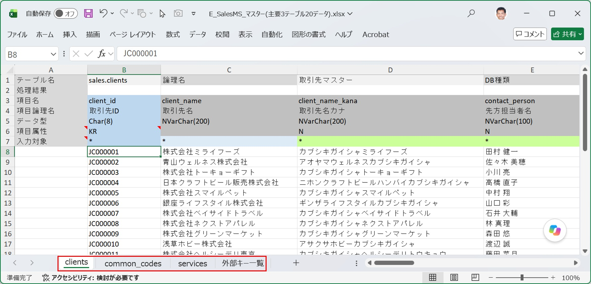

   

入力シート作成ダイアログの入力シートのパス入力欄にこの入力シートを指定した場合の既存ブックの扱いオプション別の動作を以下にお見せします。 
※各オプション別の動作開始時には操作対象シートはここに表示する元の状態に戻っているものとします。

###  既存ファイルを上書きして新規作成

1. この入力シートのテーブルシートを departments(部門マスター) と employees(従業員マスター)、services(サービスマスター) に全面的に置き換えることになりました（元のファイルは別名で保存済みでるとします）。 
この3つのテーブルを選択済みテーブルにしていて入力シート作成ダイアログを開きます。 
既存ブックの扱いオプションから「既存ファイルを上書きして新規作成」を選択します。

   

   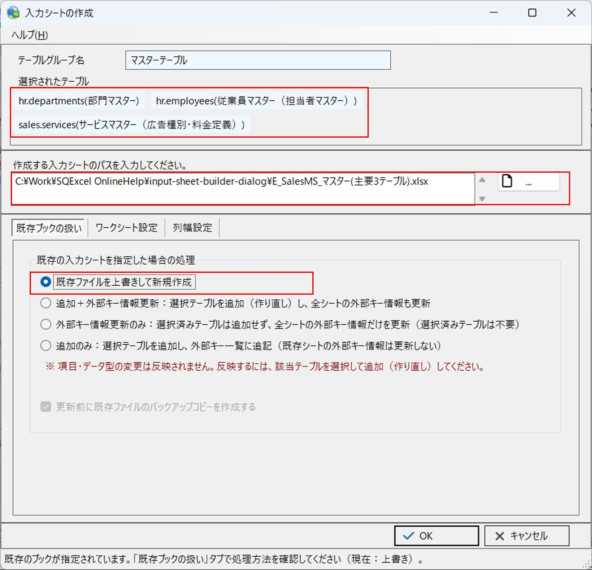

   

2. OKをクリックすると処理内容を確認する以下のようなダイアログメッセージが表示されます。

   

   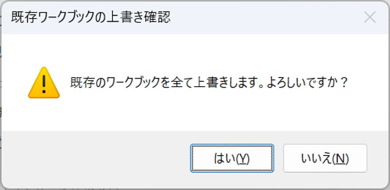

   

3. 既存のワークブックが選択済みテーブルに指定された3つの空白のテーブルシートを持つ新規の入力シートとして保存されました。元々存在したテーブルシートのうちclientsとcommon_codesは削除されています。またservicesは入力データが全てクリアされて空白の入力シートになっています。

   

   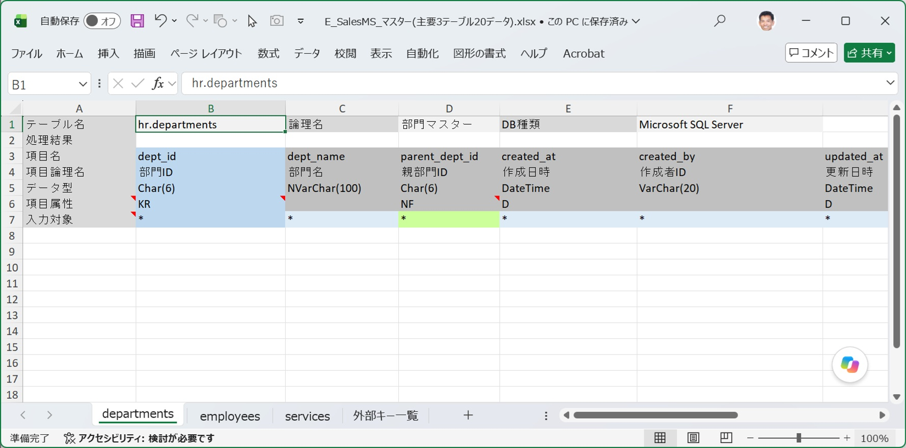

   

### 追加＋外部キー情報更新

1. 操作対象シートに3つのテーブルを追加して、1つのワークブックで5つのテーブルデータを管理することになりました。追加するテーブルのうち2つは departments(部門マスター) と employees(従業員マスター)、残る1つはブック内に既に入力シートが存在する services(サービスマスター) です。 
既存ブックの扱いオプションから「追加＋外部キー情報更新」を選択します。

   

   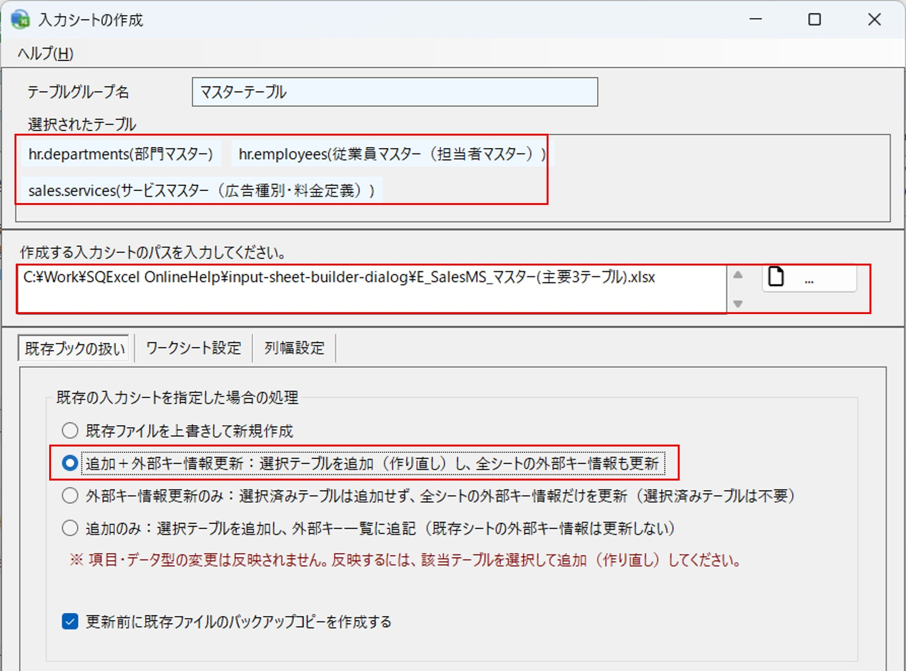

   

2. この状態でOKをクリックすると処理内容を確認する以下のようなダイアログメッセージが表示されます。

   

   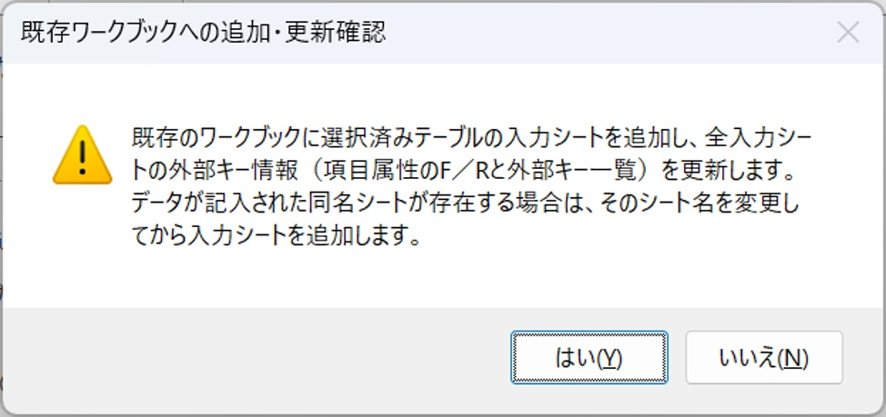

   

3. 既存のワークブックに指定されたテーブルの入力シートが追加されました。

   

   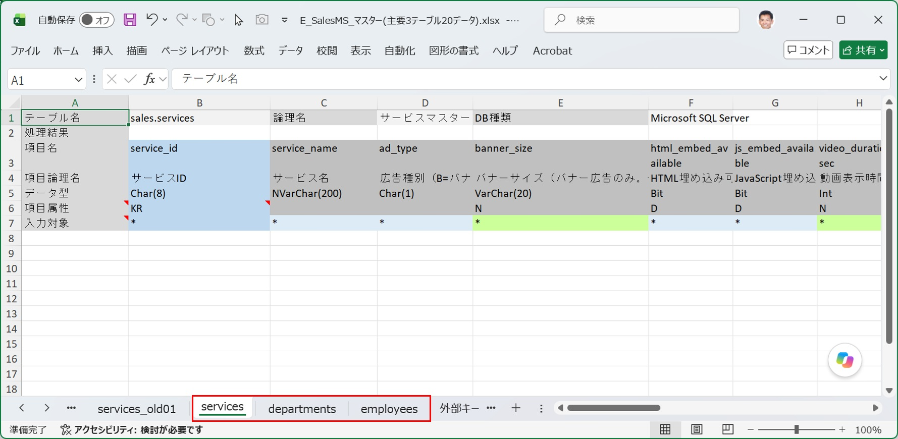

    元々存在していた services テーブル用の入力シートにはデータが書き込まれていたため `services_old01` にリネームされ、新たに入力エリアが空の services シートが追加されています。

   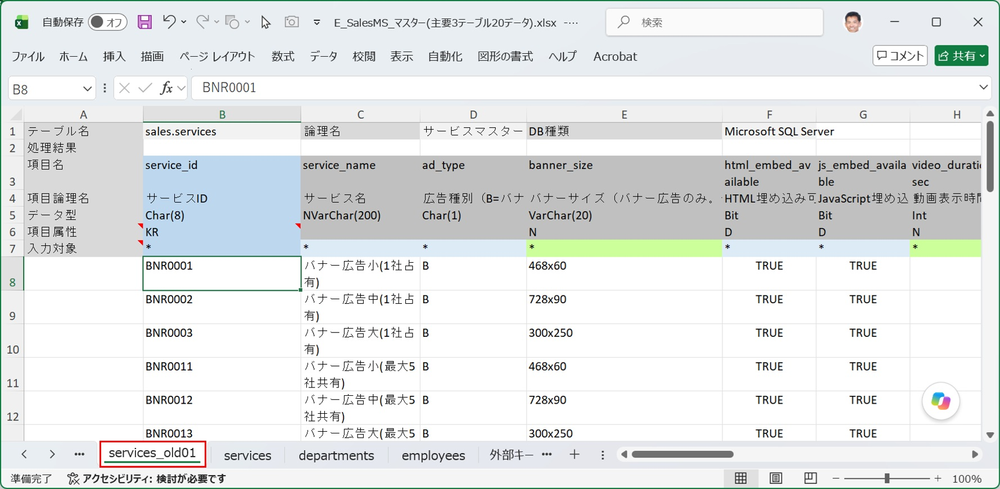

   

   「選択済みテーブルだけ追加・上書き」モードでは、対象テーブルの既存シートについて、データ入力エリアに何らかの書き込みがあるかどうかで挙動が変わります。

   

   - **データが書き込まれている場合**：既存シートは `_oldXX`（XXは2桁16進連番）という名前にリネームして温存し、新しく生成したシートをその直後の位置に挿入します
   - **データが書き込まれていない（未使用の）場合**：その場で同じ位置のシートを上書きします

   

   シートの並び順は、上記のリネーム＋直後挿入のケースを除き、既存の並びを維持し、新規テーブルのシートは末尾に追加されます。

### 外部キー情報更新のみ

1. 操作対象シートの外部キー参照制約が変更されたため入力シートのデータを保持した状態で入力シートを更新することにしました。 
既存ブックの扱いオプションから「外部キー情報更新のみ」を選択します。

   

   

   

2. この状態でOKをクリックすると処理内容を確認する以下のようなダイアログメッセージが表示されます。

   

   

   

3. ワークブック上の既存のテーブルシートの外部キー情報（タイトル行の項目属性セル）が更新されました。

   

   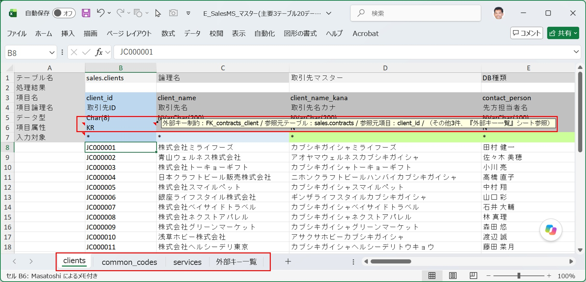

    項目ヘッダの項目属性セル内の外部キー参照情報がコメントと共に更新されます。

   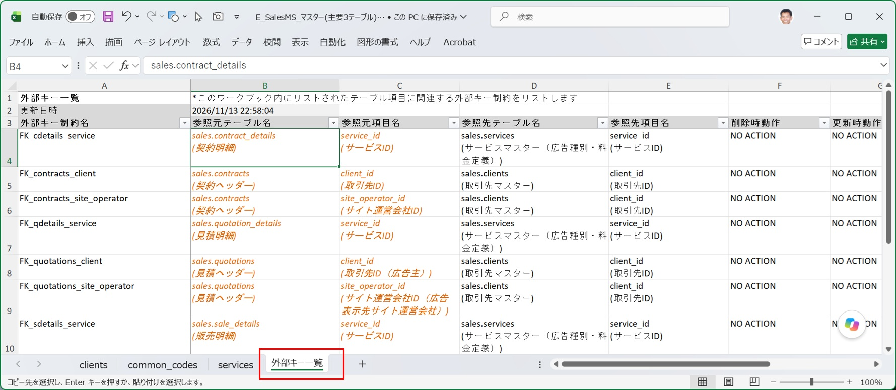
   
    外部キー一覧シートも修正されます。

   

### 追加のみ

1. 操作対象シートに3つのテーブルを追加することになりました。追加するテーブルは「追加＋外部キー情報更新」と同じですが、既存テーブルシートの外部キー情報の更新は行いません。 
※このオプションは入力シートに10個以上のように多数のテーブルシートが含まれていて、かつそれらの外部キー情報に変更がないことが明らかなときに、そこに少数のテーブルシートを追加する際に使用します。既存のテーブルシートの外部キー情報を再取得する時間を省略するためです。 
既存ブックの扱いオプションから「追加のみ」を選択します。

   

   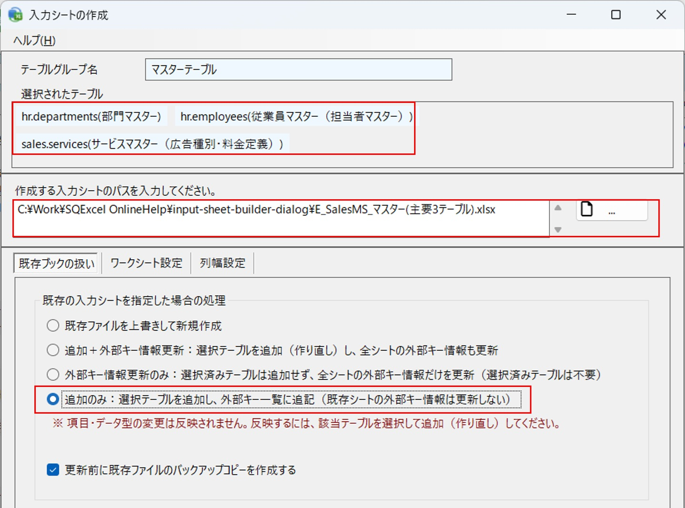

   

2. この状態でOKをクリックすると処理内容を確認する以下のようなダイアログメッセージが表示されます。

   

   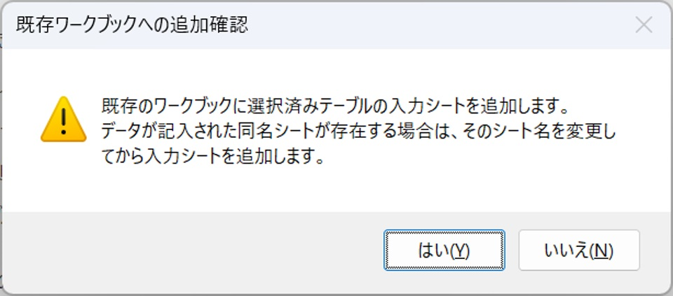

   

   「選択済みテーブルだけ追加・上書き」モードでは、対象テーブルの既存シートについて、データ入力エリアに何らかの書き込みがあるかどうかで挙動が変わります。この挙動は[追加＋外部キー情報更新](#追加外部キー情報更新)と同じなので、そちらをご参照ください

3. 既存のワークブックに指定されたテーブルの入力シートが追加されました。

   

   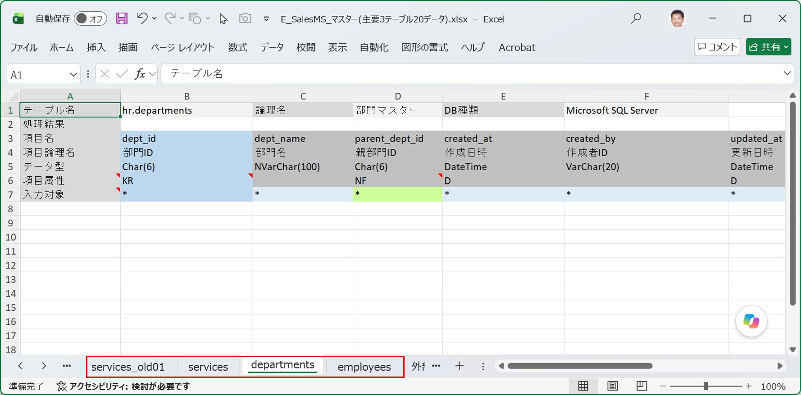

    元々存在していた services テーブル用の入力シートにはデータが書き込まれていたため `services_old01` にリネームされ、新たに入力エリアが空の services シートが追加されています。

   
