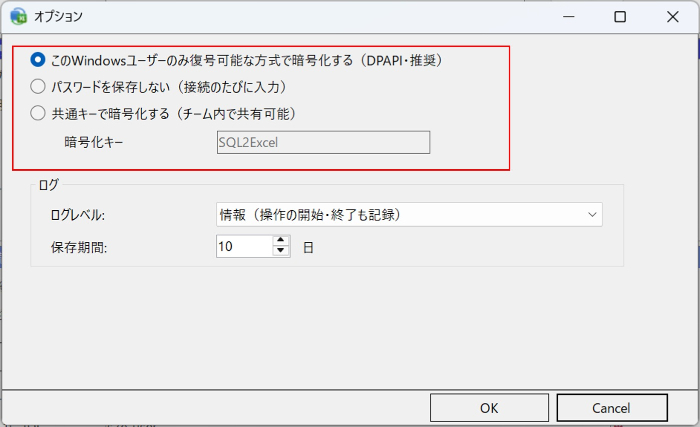
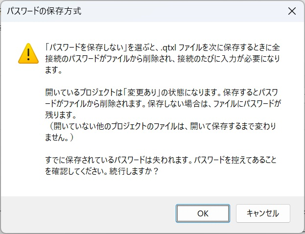
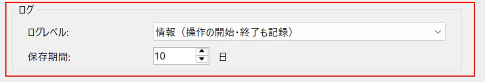
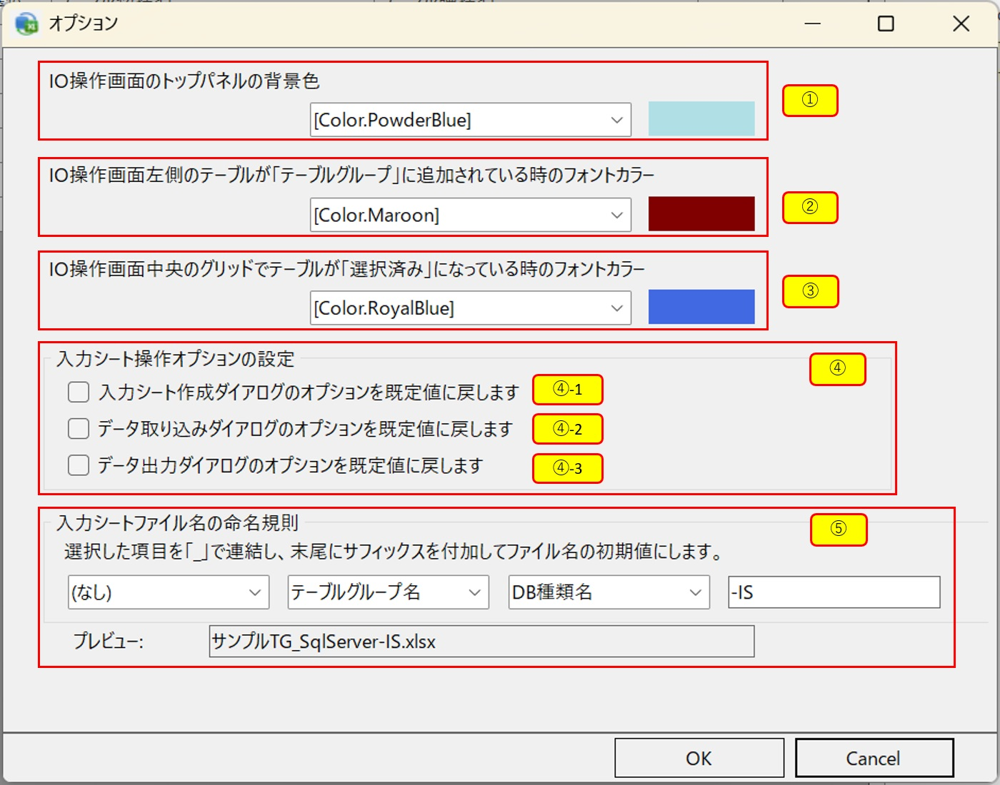
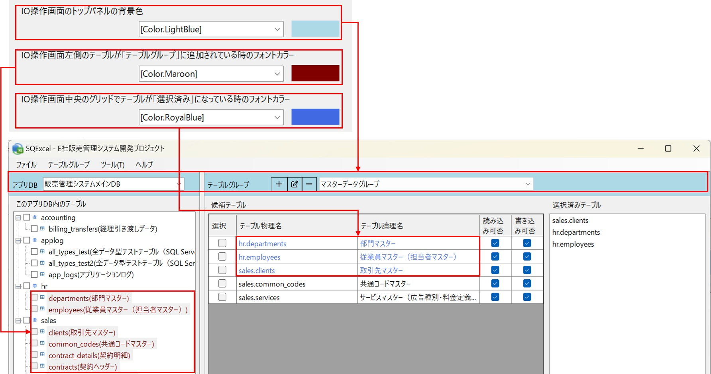
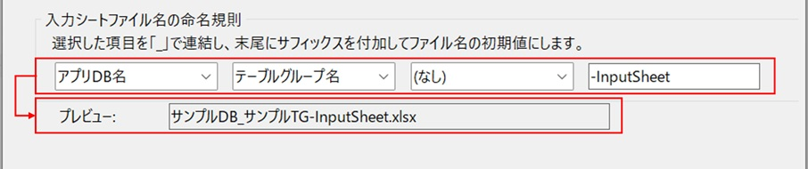

オプション設定ダイアログは、SQExcelのアプリケーション設定を変更する画面です。SQExcelのデータモデル階層の各種設定はホーム画面から、Excel入力シートの操作に関する設定はIO操作画面から実行しますが、これらの画面から実行できない細かい設定を行うためのダイアログ画面です。

オプション設定ダイアログで設定できる項目は、ホーム画面から開く場合と、IO操作画面から開く場合とで異なります。以下に順番に説明します。

## ホーム画面から開くオプション設定

ホーム画面のトップメニューから「ツール → オプション」を選択すると、下図のようなオプション設定画面が開きます。

### パスワード暗号化設定

`.qtxl` ファイルに保存する DB 接続パスワードの保存方式を、次の3つから選択します。
1. このWindowsユーザーのみ復号可能な方式で暗号化する（DPAPI・推奨・既定）
2. 共通キーで暗号化する（チーム内で共有可能）
3. パスワードを保存しない（接続のたびに入力）

- 「暗号化キー」欄は、2を選んだときだけ有効になります。暗号化キーの初期値は「SQL2Excel」です。初期値のままでは第三者に推測されやすいため、共通キー方式を使うときはキーを変更することをお勧めします。

   

:::caution[平文での保存はできません]
平文では保存できなくなりました（旧版の平文ファイルは読み込めますが、次に保存したときに暗号化されます）。「保存しない」を選ぶと、ファイルにはパスワードが書き込まれません。
:::

#### 3つの保存方式の比較

| 方式 | ファイル上の形式 | 他のPC・Windowsユーザーで開けるか | チームでの共有 | 向いている使い方 | 注意点 |
|---|---|---|---|---|---|
| DPAPI（既定） | このWindowsユーザーに紐づけて暗号化 | 復号できない。接続時にパスワード入力が必要 | 向かない | 個人利用 | WindowsのアカウントのパスワードリセットなどでDPAPIの鍵が変わると復号できなくなる場合がある |
| 共通キー | 暗号化キーで暗号化 | 暗号化キーが同じなら可 | チームで同じキーを設定して共有 | チーム共有 | 暗号化キーが異なると復号に失敗する。従ってこの方式を使用して.qtxlファイルを共有するメンバー間では暗号化キーを共有する必要がある。 |
| 保存しない | ファイルにパスワードを書かない | — | パスワードは各自入力 | 共有したくない/できないパスワード | 接続のたびに（セッション中は1回）入力が必要 |

#### セキュリティ上の重要な注意
- `.qtxl` ファイルとパスワード（暗号化キーを含む）が一緒に漏れた場合は、データベースに繋がる環境からの悪意ある第3者からの攻撃を防ぐことが出来ません。共通キー方式は難読化に近いものではありますが、強固な機密保護ではありません。
- 他の人から受け取った `.qtxl` を開くときは、接続先（サーバー・データベース）を確認してから接続してください。
- `.qtxl` をメール等で渡すときは、パスワードや暗号化キーを別の経路で伝えるか、「保存しない」方式の利用を検討してください。

#### 「パスワードを保存しない」を選んでOKしたとき
- 「保存しない」を選んで［OK］をクリックすると、確認メッセージ（「パスワードの保存方式」ダイアログ。続行／キャンセル）が表示されます。

   

- 開いているプロジェクトは「変更あり」の状態になります。保存すると、ファイルから全接続のパスワードが削除されます。保存せずに終了すると、ファイルにはパスワードが残ります。
- すでに保存されていたパスワードは失われます。パスワードを控えてから実行してください。
- 開いていない他のプロジェクトのファイルは、開いて保存するまで変わりません。
- 方式を「保存しない」から戻した場合は、入力済みのパスワードが復元されます。

#### 保存方式の適用範囲と保存・読み込み時の動作
- 保存方式は、アプリケーション全体（このPC・このユーザー）の設定で、`.qtxl` ファイルには方式を書きません。プロジェクトごとの選択はできません。
- 保存時：現在選択中の方式でパスワードを書き込みます。
- 読み込み時：方式にかかわらず、すべての形式（平文・共通キー・DPAPI）を復号して読み込みます。
- 方式を変更しただけではファイルは変わりません。次に `.qtxl` を保存したときに、新しい方式で書き込まれます。保存済みのファイルを開いて保存し直さない限り、古い方式のまま残ります。

#### チームで使うときの運用の目安
- チームに規定がなければ、各ユーザーが自分の用途に合う方式を選びます。
- DB接続のパスワードは、少なくとも1回は入力が必要になります（DPAPI／保存しない方式で他の人のファイルを開いたとき等）。
- 同じ `.qtxl` をチームで共有したい場合は共通キー方式（同じ暗号化キーを全員に設定）、共有したくない/できないパスワードは「保存しない」方式、といった使い分けができます。

### ログの設定
SQExcelは所定のフォルダにログを記録する。
ログファイルは予期せぬエラーが発生した場合にその原因調査のために使用するのが主な目的である。
ベンダーに対するエラーの調査依頼はSQExcelのGitHub上のissuesを通じて行うが、その際に添付資料としてログファイルを使用する。（[ツール->診断情報を保存]によりログファイル上の機密情報をマスクして出力することが可能）

- ログレベル
    - 警告：プログラム実行時に発生したエラーや例外情報のみを記録する。
    - 情報：エラーや例外情報に加え、ユーザーがどのような操作を行ったかも記録する。

- 保存日数：ログの保存日数。この日数を越えたログデータは自動的に消去される。

   

## IO操作画面から開くオプション設定

IO操作画面のメニュー「ツール → オプション」から開くオプション設定画面では、IO操作画面や入力シート操作全般に関わる設定をここで一括管理します。設定はモーダルダイアログで、「OK」でコミット、「キャンセル」で破棄されます。

   

### ノード・パネルの色設定

| No. | 設定項目（ダイアログの表示ラベル） | 対象 |
|---|---|---|
| ① | IO操作画面のトップパネルの背景色 | [IO操作画面](/ja/docs/features/io-operations/) 上部、アプリDB選択・テーブルグループ選択コンボボックス周辺パネルの背景色 |
| ② | IO操作画面左側のテーブルが「テーブルグループ」に追加されている時のフォントカラー | スキーマ・テーブルツリーで、テーブルグループに追加済みのノードの文字色 |
| ③ | IO操作画面中央のグリッドでテーブルが「選択済み」になっている時のフォントカラー | 候補テーブルグリッドで選択済み（読み込み・書き込み対象）になっているテーブル行の文字色 |

   

:::tip[設定はOK後すぐに反映されます]
色を変更してOKをクリックすると、開いたままのIO操作画面上でも即座に再描画され、ダイアログを開き直す必要はありません。
:::

### 入力シート操作オプションのリセット

[入力シート作成](/ja/docs/features/io-operations/input-sheet-builder-dialog/)・[データ取り込み](/ja/docs/features/io-operations/data-import-dialog/)・[データ出力](/ja/docs/features/io-operations/data-export-dialog/) の各ダイアログのオプション（SQL種類、スタイル、インデント等）は、次回ダイアログ表示時に前回設定を自動的に復元します。このセクションでは、それらをアプリ既定値にリセットできます。

- チェックボックスは、対応するオプションが「既定値と異なる（一度でも変更されたことがある）」場合のみ活性化されます。空の場合は操作不要です。
- OKをクリックすると、チェックしたオプション種別のみが既定値にリセットされる旨の確認アラートが表示され、確認後にリセットが実行されます。

   

### 入力シート命名規則の設定

[入力シート作成ダイアログ](/ja/docs/features/io-operations/input-sheet-builder-dialog/) が既定で提案するファイル名の規則を、トークンの組み合わせで設定できます。

   

- 3つのスロットにはそれぞれ「なし」「アプリDB名」「DB種類名」「テーブルグループ名」のいずれかを選択し、`_` で連結します
- 自由入力のサフィックス（既定値：`-InputSheet`。空欄も可）
- 選択の結果プレビューテキストボックスにファイル名の例が表示されます。

命名規則はプロジェクト全体で1つ設定します（テーブルグループごとの個別ルールはありません）。

これら以外の設定変更後に再起動が必要な項目については、ダイアログ内でその旨が明示されます。
